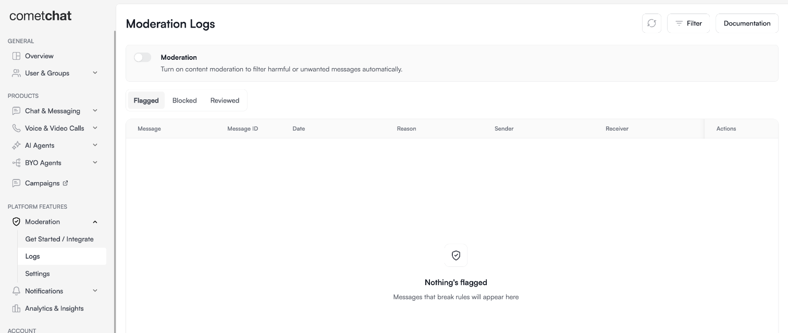

**Moderation Logs** shows the messages your moderation rules and your users have acted on.

**Where:** left navigation → **Platform Features** → **Moderation** → **Logs**. **Chat & Messaging → Moderation** opens the same page.

<Frame>
  
</Frame>

| Element | Description |
| --- | --- |
| **Moderation** toggle | Turns content moderation on or off for the app. Off by default. |
| Refresh icon | Reloads the table. |
| **Filter** | Adds **Category** and **Select Date** filters. |
| **Documentation** | Opens the moderation docs. |

## Tabs

| Tab | Columns | Contents |
| --- | --- | --- |
| **Flagged** | **Message**, **Message ID**, **Date**, **Reason**, **Sender**, **Receiver**, **Actions** | Messages flagged by a rule or reported by users. Use row actions to review them. See [Flagged messages](/moderation/flagged-messages). |
| **Blocked** | **Message**, **Violation ID**, **Sender**, **Receiver**, **Date**, **Actions** | Messages blocked before delivery. See [Blocked messages](/moderation/blocked-messages). |
| **Reviewed** | **Message**, **Violation ID**, **Reason**, **Sender**, **Receiver**, **Date**, **Actions** | Messages a moderator has already reviewed. See [Reviewed messages](/moderation/reviewed-messages). |
