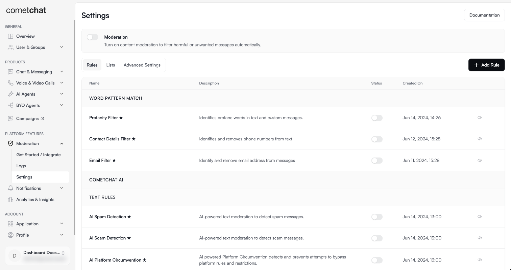
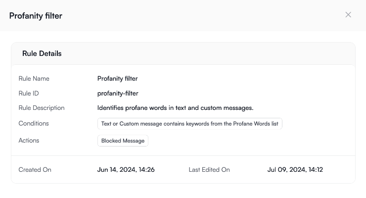
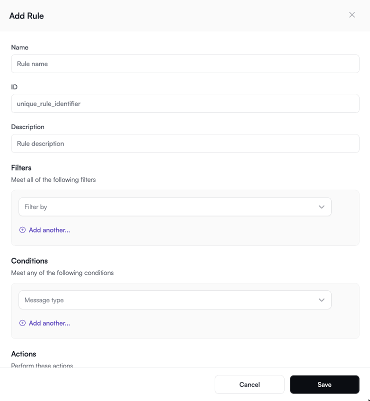
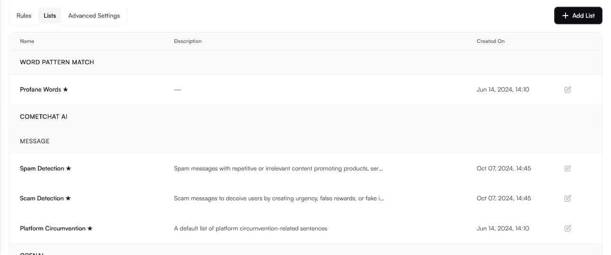
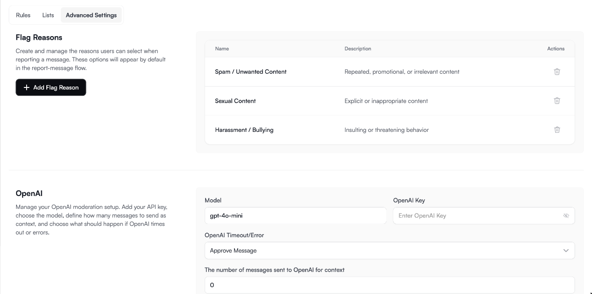

**Settings** is where you decide what gets moderated and how.

**Where:** left navigation → **Platform Features** → **Moderation** → **Settings**.

<Frame>
  
</Frame>

The **Moderation** toggle at the top turns moderation on or off for the whole app (off by default). Rules run only while it's on.

## Rules

Each rule has a **Name**, **Description**, **Status** toggle, **Created On** date, and a view (eye) icon that opens **Rule Details**. Rules marked ★ are predefined by CometChat. All rules are off by default; turn a rule's **Status** on to use it.

| Group | Predefined rules |
| --- | --- |
| **Word Pattern Match** | Profanity Filter, Contact Details Filter (phone numbers), Email Filter |
| **CometChat AI → Text Rules** | AI Spam Detection, AI Scam Detection, AI Platform Circumvention, AI Message Toxicity |
| **CometChat AI → Media Rules** | AI Image Moderation (Unsafe & Prohibited Content), AI Video Moderation (Unsafe & Prohibited Content), Malware & Virus Scanner |
| **OpenAI → Message** | Spam And Scam, Non-Consensual Sexual Content Or Exploitation, Impersonation Or Fraud, Hate And Harassment, Privacy And Sensitive Info, Explicit Or Inappropriate Content, Violent Or Terroristic Threats, Self-Harm Or Suicidal Content (all languages) |
| **OpenAI → Image** | Explicit Or Sexual Content, Fraud Or Scam Indicators, Privacy Or Personal Data, Self-Harm Or Suicidal Content, Minor Safety And Exploitation, Hate Or Harassment, Graphic Violence Or Gore, Terrorism Or Extremist Promotion |

<Note>
OpenAI rules need an OpenAI key in [Advanced Settings](#advanced-settings).
</Note>

### Rule details

<Frame>
  
</Frame>

Shows the **Rule Name**, **Rule ID**, **Rule Description**, **Conditions** (for example "Text or Custom message contains keywords from the Profane Words list"), **Actions** (for example **Blocked Message**), **Created On**, and **Last Edited On**.

### Add a rule

Click **Add Rule**.

<Frame>
  
</Frame>

| Section | Description |
| --- | --- |
| **Name**, **ID**, **Description** | Rule name, a unique rule identifier, and a description. |
| **Filters** | Meet **all** of these filters. **Filter by** **Sender** or **Receiver**. Click **Add another...** for more. |
| **Conditions** | Meet **any** of these conditions. Start with a **Message type** (**Text**, **Image**, **Video**, **File**, **Audio**) and define what to detect. Click **Add another...** for more. |
| **Actions** | What to do on a match. **Message Action**: **Block** or **Flag**. **User Action**: **Block User**. **Group Action**: **Kick User** or **Ban User**. |

Click **Save** to create the rule. See [Rules management](/moderation/rules-management) for condition types and examples.

## Lists

Lists hold the keywords, sentences, or prompts that rules check against. Lists marked ★ are predefined. Click the edit icon to change a list, or **Add List** to create one.

<Frame>
  
</Frame>

| Group | Predefined lists |
| --- | --- |
| **Word Pattern Match** | Profane Words |
| **CometChat AI → Message** | Spam Detection, Scam Detection, Platform Circumvention |
| **OpenAI → Message** | Prompts used by the OpenAI rules (for example Violent Or Terroristic Threats Prompt, Impersonation Or Fraud Prompt) |

See [Lists management](/moderation/lists-management).

<a id="advanced-settings" />
## Advanced Settings

<Frame>
  
</Frame>

### Flag Reasons

The reasons users can pick when they report a message. They appear by default in the report-message flow. Defaults:

| Name | Description |
| --- | --- |
| Spam / Unwanted Content | Repeated, promotional, or irrelevant content |
| Sexual Content | Explicit or inappropriate content |
| Harassment / Bullying | Insulting or threatening behavior |

Click **Add Flag Reason** to add one, or the trash icon to remove one.

### OpenAI

| Field | Default | Description |
| --- | --- | --- |
| **Model** | `gpt-4o-mini` | OpenAI model used by OpenAI rules. |
| **OpenAI Key** | Empty | Your OpenAI API key. |
| **OpenAI Timeout/Error** | Approve Message | What happens if OpenAI times out or errors: **Approve Message** or **Drop Message**. |
| **The number of messages sent to OpenAI for context** | `0` | How many previous messages to include as context. |

Click **Save**. See [OpenAI moderation](/moderation/open-ai/openai-overview).

### Custom API

Use your own moderation server.

| Field | Default | Description |
| --- | --- | --- |
| **On Custom API Error** | Approve Message | What happens to the message if your API returns an error. |
| **The number of messages sent to Custom API for context** | — | How many previous messages to include as context. |

Click **Save**. See [Custom API moderation](/moderation/custom/custom-api-overview).
