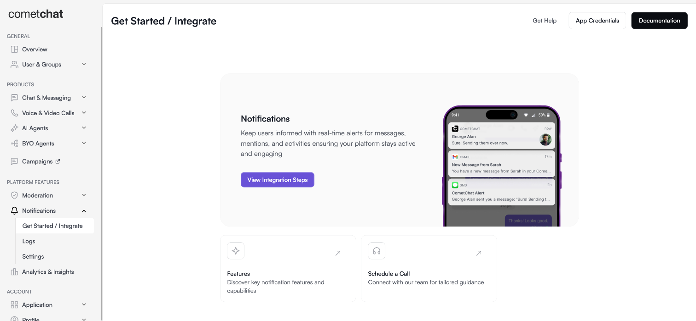

**Get Started / Integrate** guides you through setting up push, email, or SMS notifications.

**Where:** left navigation → **Platform Features** → **Notifications** → **Get Started / Integrate**.

<Frame>
  
</Frame>

Click **View Integration Steps** to show the guide.

<Steps>
  <Step title="Which type of notification do you want to configure?">
    Choose **Push notifications**, **Email notifications**, or **SMS notifications**.
  </Step>
  <Step title="Set up credentials">
    - **Push**: add FCM or APNs keys, or a custom provider. **Open Dashboard Settings** opens [Notifications → Settings](/dashboard/notifications/settings); **View Setup Guide** opens the [push guide](/notifications/push-getting-started).
    - **Email**: use SendGrid or a custom email provider. See [Email notifications](/notifications/email-overview).
    - **SMS**: use Twilio or a custom SMS provider. See [SMS notifications](/notifications/sms-overview).
  </Step>
  <Step title="Add notifications to your frontend">
    For push, choose **Code** or **No Code** and your platform, then follow **Go to Integration Guide**. You register device tokens with the SDK; users then get alerts for messages, replies, mentions, reactions, and calls.
  </Step>
</Steps>
