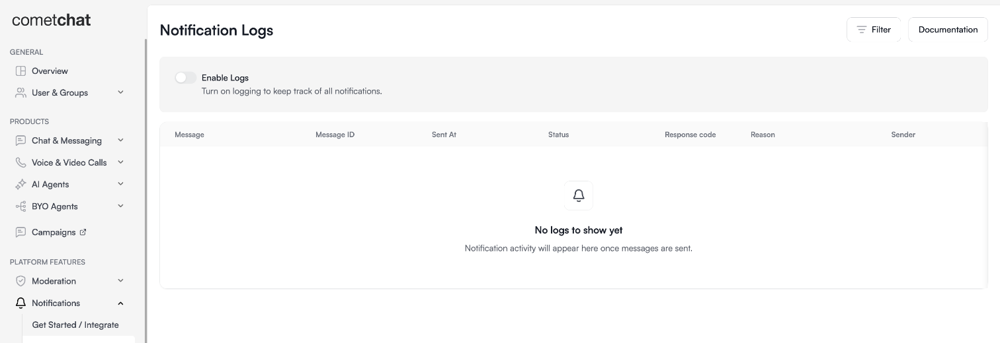

**Notification Logs** records each notification CometChat tries to send, so you can debug why a user did or didn't get a notification.

**Where:** left navigation → **Platform Features** → **Notifications** → **Logs**.

<Frame>
  
</Frame>

| Element | Description |
| --- | --- |
| **Enable Logs** | Turn on logging to keep track of all notifications. Off by default; nothing is recorded while it's off. |
| **Filter** | Adds filters above the table. |
| **Documentation** | Opens the [notification logs docs](/notifications/logs). |

## Columns

**Message**, **Message ID**, **Sent At**, **Status**, **Response code**, **Reason**, **Sender**, **Notification Triggered**, **Trigger**, **Error response**, **Success response**, **Push provider ID**, **Push token**, **Push token type**, **Provider**, **Receiver**, **Receiver type**, **Channel**, **Category**, **Type**, **Member**, **Reaction ID**, **Reaction Sender**, **Reaction Receiver**.

Scroll the table horizontally to see all columns.
