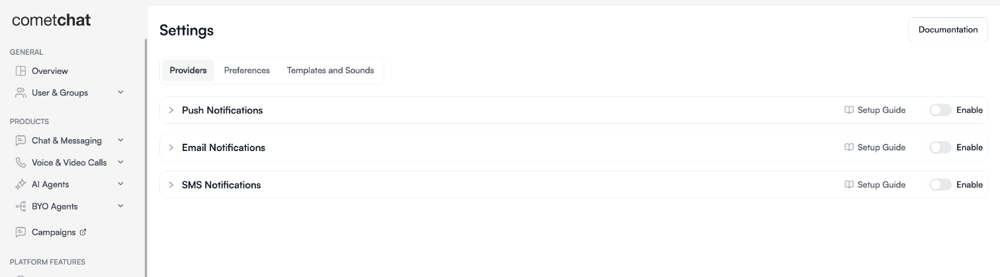
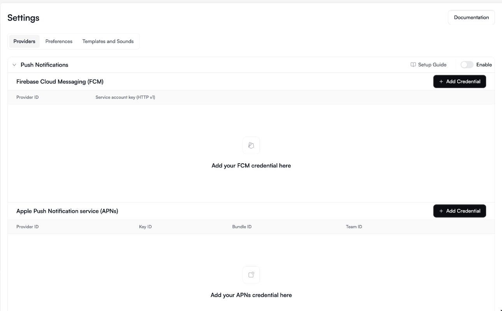
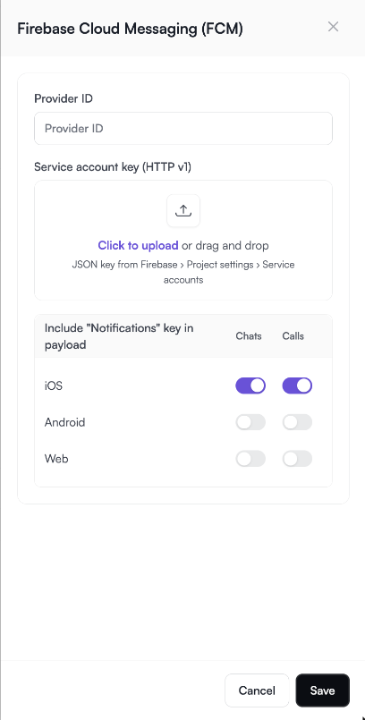
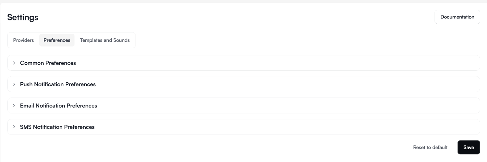
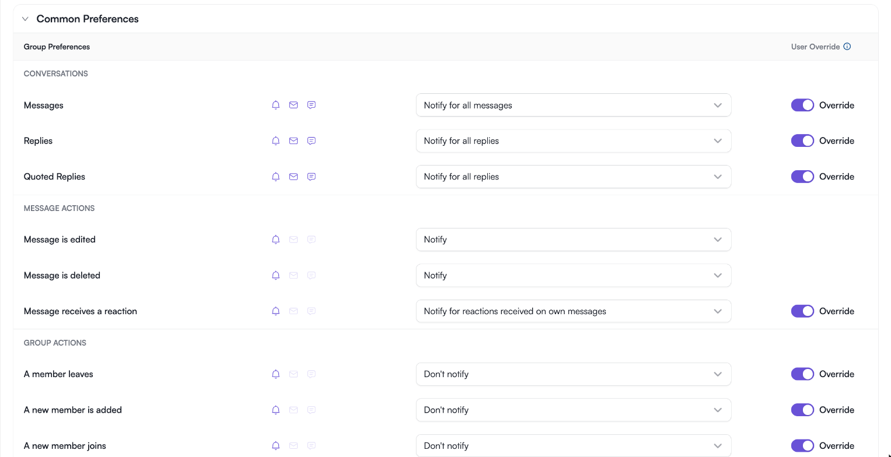
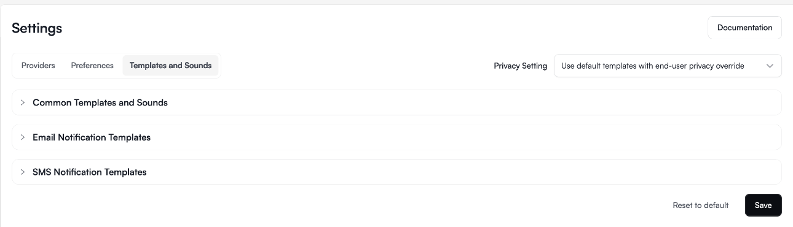

**Settings** configures how CometChat delivers notifications. It has three tabs: **Providers**, **Preferences**, and **Templates and Sounds**.

**Where:** left navigation → **Platform Features** → **Notifications** → **Settings**.

<Frame>
  
</Frame>

## Providers

Each channel has an **Enable** toggle (off by default) and a **Setup Guide** link. Expand a channel to add credentials.

### Push Notifications

<Frame>
  
</Frame>

| Provider | Table columns | Credential form |
| --- | --- | --- |
| **Firebase Cloud Messaging (FCM)** | **Provider ID**, **Service account key (HTTP v1)** | **Provider ID**; **Service account key (HTTP v1)**: upload the JSON key from Firebase › Project settings › Service accounts; **Include "Notifications" key in payload** toggles for **Chats** and **Calls** on **iOS** (on by default), **Android**, and **Web**. |
| **Apple Push Notification service (APNs)** | **Provider ID**, **Key ID**, **Bundle ID**, **Team ID** | **Enable Production Mode**; **Provider ID**; **Key ID**; **Team ID**; **Bundle ID**; **Auth key (.p8)**: upload the P8 key from Apple Developer › Certificates, IDs & Profiles › Keys; **Include content-available**; **Include mutable-content**. |
| **Custom Push Notification Provider** | **Provider URL** | Your provider's webhook URL. See [Custom providers](/notifications/custom-providers). |

Click **Add Credential** to open the form, then **Save**. You can add several credentials per provider; the **Provider ID** identifies which one the SDK uses when it registers a device token.

<Frame>
  
</Frame>

### Email Notifications

Providers: **SendGrid** or **Custom Email Provider**. See [Email integration](/notifications/email-integration) and [Custom email providers](/notifications/email-custom-providers).

### SMS Notifications

Providers: **Twilio** or **Custom SMS Provider**. See [SMS integration](/notifications/sms-integration) and [Custom SMS providers](/notifications/sms-custom-providers).

## Preferences

App-wide defaults for when users are notified. Expand a section, change values, and click **Save**. **Reset to default** restores CometChat's defaults.

<Frame>
  
</Frame>

<Frame>
  
</Frame>

Rows with an **Override** toggle let end users change that preference from your app (**User Override**). The bell, envelope, and chat icons show which channels (push, email, SMS) the row applies to.

### Common Preferences

| Section | Rows (default) |
| --- | --- |
| **Group Preferences** | Messages (Notify for all messages), Replies (Notify for all replies), Quoted Replies (Notify for all replies), Message is edited (Notify), Message is deleted (Notify), Message receives a reaction (Notify for reactions received on own messages), A member leaves / is added / joins / is kicked / is banned / is unbanned, A member's scope changes (Don't notify) |
| **One-on-one Preferences** | Messages, Replies, Quoted Replies, Message is edited, Message is deleted, Message receives a reaction (same defaults as groups) |
| **Call Preferences** | Call initiated, ongoing, cancelled, rejected, unanswered, busy, ended (Notify) |
| **Mute Preferences** | Mute all notifications (DND), Mute group conversations, Mute one-on-one conversations (user configurable); Ignore end user mute preferences if user is mentioned in message; Ignore end user mute preferences on @all |
| **Notification Schedule** | Hours when notifications are delivered, per weekday (default 00:00 to 23:59 every day), with **Override** |

### Push Notification Preferences

**Push Payload Message Options**: Include entire message object, Include message metadata, Include sender's metadata, Include receiver's metadata, Trim CometChat message object. **Additional Data in Payload**. **Unread Badge Count**: Enable unread badge count (see [Badge count](/notifications/badge-count)).

### Email Notification Preferences

| Setting | Default |
| --- | --- |
| Notify for unread messages only | Toggle, with **Override** |
| Wait time before sending the next notification (per conversation), in minutes | 120 |
| Maximum emails per day | 20 |
| Maximum emails per conversation per day | 2 |
| Email Payload Message Options | Include entire message object, message metadata, sender's metadata, receiver's metadata |

### SMS Notification Preferences

Same settings as email: notify for unread messages only, wait time between notifications, **Maximum SMSes per day**, **Maximum SMSes per conversation per day**, and SMS payload message options.

See [Preferences](/notifications/preferences) for how preferences combine with user settings.

## Templates and Sounds

<Frame>
  
</Frame>

**Privacy Setting** chooses which templates are used:

| Option | Behavior |
| --- | --- |
| **Use default templates** | Notifications show message content. |
| **Use privacy templates** | Notifications hide message content. |
| **Use default templates with end-user privacy override** (default) | Default templates, but users can switch to privacy templates in your app. |

**Common Templates and Sounds** has a **Default** and a **Privacy** template for each message kind: Text Message, User Mention, @all Mention, Media Message (separate bodies for image, audio, video, and file), Card Message, Poll Message, Reminder Message, Custom Message, Interactive Form, Interactive Card, Interactive Scheduler, and Custom Interactive Message. Each has **Title for one-on-one**, **Title for group**, and **Body** fields (some also have **Body (Fallback)**). The **Sounds** section sets notification sounds for calls.

**Email Notification Templates** and **SMS Notification Templates** hold the templates for those channels. Click **Save** to apply changes. See [Templates and sounds](/notifications/templates-and-sounds).
