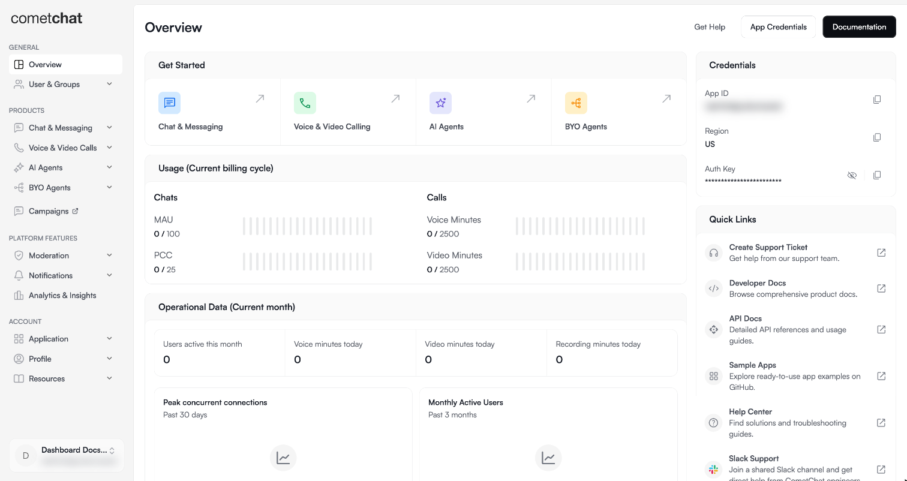

**Overview** is the first page you see when you open an app. Use it to check usage against your plan, find your credentials, and jump into a product.

**Where:** left navigation → **General** → **Overview**.

<Frame>
  
</Frame>

## Get Started

Four cards open the **Get Started / Integrate** page for each product:

| Card | Opens |
| --- | --- |
| **Chat & Messaging** | [Chat & Messaging → Get Started / Integrate](/dashboard/chat/get-started) |
| **Voice & Video Calling** | [Voice & Video Calls → Get Started / Integrate](/dashboard/calls/get-started) |
| **AI Agents** | [AI Agents → Get Started / Integrate](/dashboard/ai-agents/get-started) |
| **BYO Agents** | [BYO Agents → Get Started / Integrate](/dashboard/byo-agents/get-started) |

## Usage (current billing cycle)

Meters show how much of your plan's allowance you have used in the current billing cycle. The number after the slash is your plan limit (on the free **Build** plan, for example, 100 MAU and 25 PCC).

| Meter | Meaning |
| --- | --- |
| **MAU** (Chats) | Monthly active users: unique users who connected to CometChat this cycle. |
| **PCC** (Chats) | Peak concurrent connections: the highest number of users connected at the same time. |
| **Voice Minutes** (Calls) | Voice-call minutes used this cycle. |
| **Video Minutes** (Calls) | Video-call minutes used this cycle. |

<Note>
When you approach a limit, upgrade from [Plans & Billing](/dashboard/application/plans-billing).
</Note>

## Operational Data (current month)

| Tile or chart | Meaning |
| --- | --- |
| **Users active this month** | Users who were active in the current calendar month. |
| **Voice minutes today** / **Video minutes today** | Call minutes used today. |
| **Recording minutes today** | Minutes of call recording generated today. |
| **Peak concurrent connections** | Daily peak concurrent connections over the past 30 days. |
| **Monthly Active Users** | MAU for each of the past 3 months. |
| **Voice Minutes**, **Video Minutes**, **Recording Minutes**, **Transcription Minutes** | Daily usage over the past 30 days. |

Charts show **No usage as yet** until your app has traffic.

## Credentials

The right-hand panel shows the values your client code needs:

| Field | Description |
| --- | --- |
| **App ID** | Unique identifier of this app. Pass it to the SDK or UI Kit at init. |
| **Region** | Data region of the app (`US`, `EU`, or `IN`). Pass it to the SDK at init. |
| **Auth Key** | Masked by default. Click the eye icon to reveal it, or the copy icon to copy it. |

Each value has a copy button. For REST API keys and additional auth keys, open [Credentials](/dashboard/application/credentials).

<Warning>
The Auth Key lets any client log in as any user. Use it only during development. In production, create users and [auth tokens](/rest-api/auth-tokens) from your server.
</Warning>

## Quick Links

| Link | Opens |
| --- | --- |
| **Create Support Ticket** | CometChat support ticket form. |
| **Developer Docs** | This documentation site. |
| **API Docs** | REST API reference. |
| **Sample Apps** | CometChat sample apps on GitHub. |
| **Help Center** | Troubleshooting articles. |
| **Slack Support** | Shared Slack channel with CometChat engineers (where available on your plan). |
| **Community** | CometChat developer community. |
| **Product Updates** | Release announcements. |
| **Product Feedback** | Feature requests and feedback board. |
| **Status Page** | Real-time service status and maintenance notices. |
