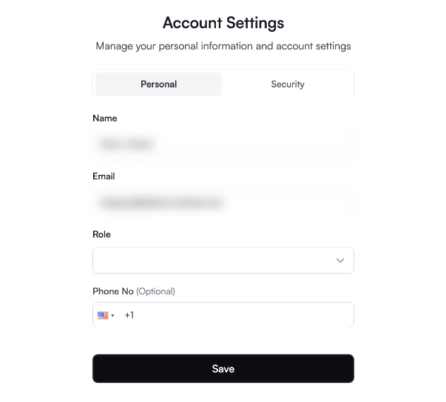
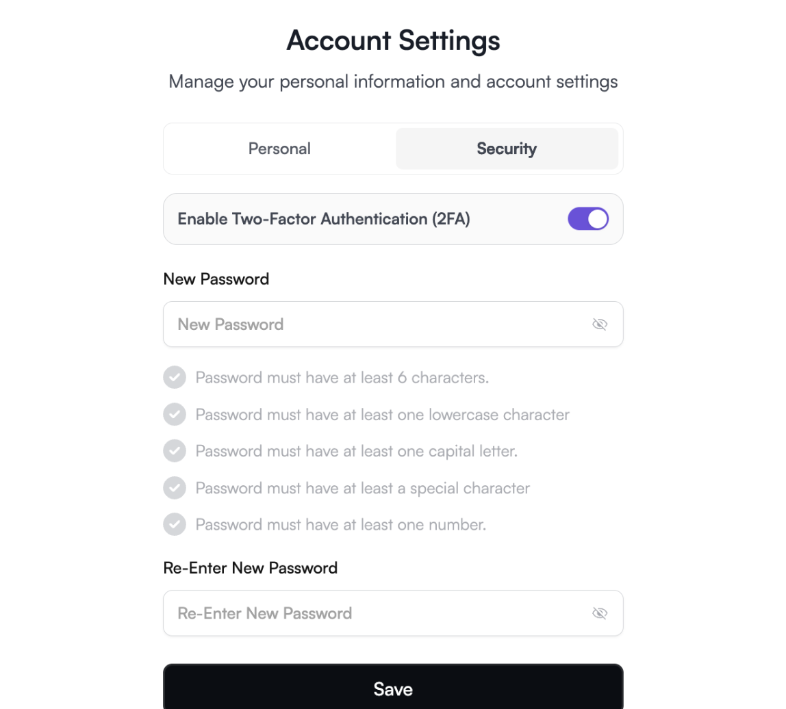

**Account Settings** manages your personal CometChat dashboard account. It applies to every app you can access.

**Where:** left navigation → **Account** → **Profile** → **Account Settings**, or open [app.cometchat.com/settings](https://app.cometchat.com/settings).

## Personal

<Frame>
  
</Frame>

| Field | Description |
| --- | --- |
| **Name** | Your name, as team members see it. |
| **Email** | Your sign-in email. |
| **Role** | Your job role: Frontend Developer, Backend Developer, Fullstack Developer, Founder, Product Manager, Engineering Manager, or Other. |
| **Phone No** | Optional phone number with country code. |

Click **Save**.

## Security

<Frame>
  
</Frame>

| Setting | Description |
| --- | --- |
| **Enable Two-Factor Authentication (2FA)** | Require a second factor when you sign in. |
| **New Password** / **Re-Enter New Password** | Change your password. It must have at least 6 characters, one lowercase letter, one capital letter, one special character, and one number. |

Click **Save**.
