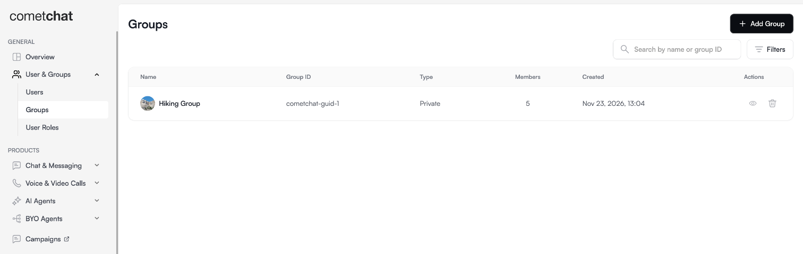
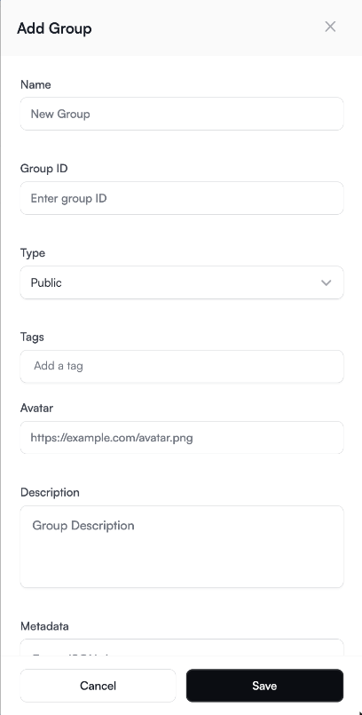
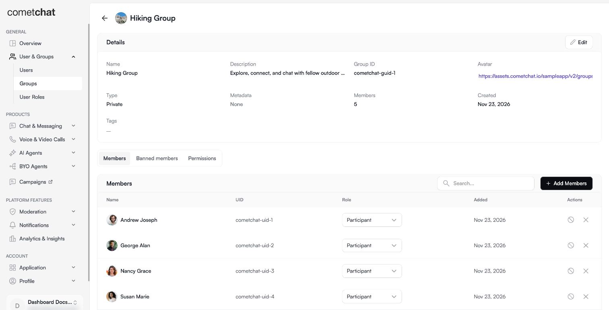
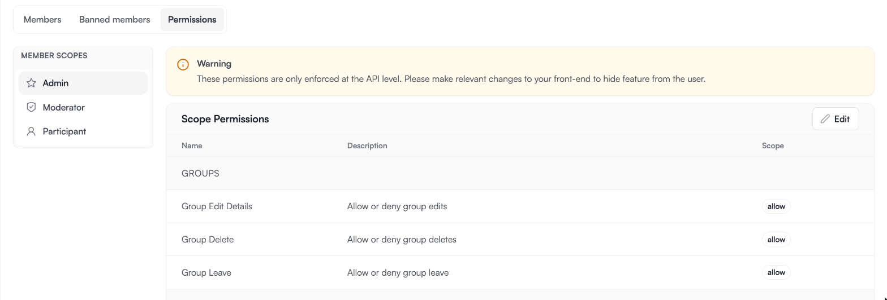

**Groups** lists every group in the app. A group is a conversation with several members. Each member has a scope (**Admin**, **Moderator**, or **Participant**) that controls what they can do in the group.

**Where:** left navigation → **User & Groups** → **Groups**.

<Frame>
  
</Frame>

## The group list

| Element | Description |
| --- | --- |
| **Search by name or group ID** | Filters the list as you type. |
| **Filters** | Adds filter chips: **GUIDs**, **Type**, **Members Count**, and **Created At Date**. |
| **Columns** | **Name**, **Group ID**, **Type**, **Members**, **Created**, **Actions**. |
| Eye icon | Opens the group detail page. |
| Trash icon | Deletes the group and its messages. This can't be undone. |

## Add a group

Click **Add Group** to open the **Add Group** panel.

<Frame>
  
</Frame>

| Field | Required | Description |
| --- | --- | --- |
| **Name** | Yes | Display name of the group. |
| **Group ID** | Yes | Unique identifier (GUID). It can't be changed later. |
| **Type** | Yes | **Public** (anyone can find and join) or **Private** (users join only when added by a member with permission). Defaults to **Public**. |
| **Tags** | No | Free-form labels for filtering. |
| **Avatar** | No | Public URL of the group icon. |
| **Description** | No | Short description shown in group details. |
| **Metadata** | No | Any extra data as a JSON object. |

Click **Save** to create the group.

## Group details

Click the eye icon on a row to open the group.

<Frame>
  
</Frame>

**Details** shows **Name**, **Description**, **Group ID**, **Avatar**, **Type**, **Metadata**, **Members**, **Created**, and **Tags**. Click **Edit** to change them (except the Group ID).

### Members

Lists members with **Name**, **UID**, **Role**, **Added**, and **Actions**.

- Use the **Role** dropdown on a row to change the member's scope: **Admin**, **Moderator**, or **Participant**.
- Click **Add Members** to add users to the group.
- Click the ban icon to **ban** a member (they're removed and can't rejoin until unbanned) or the ✕ icon to **kick** them (they're removed but can rejoin).

### Banned members

Lists banned users with **Name**, **UID**, **Scope**, **Added**, and **Actions**. Use the row action to unban a user.

### Permissions

Set what each member scope can do in **this group**. Choose a scope under **Member Scopes** (**Admin**, **Moderator**, **Participant**), then click **Edit** on **Scope Permissions**, change values, and click **Save Changes** (or **Cancel**).

<Frame>
  
</Frame>

<Warning>
These permissions are enforced only at the API level. Also hide the related controls in your front end so users don't see actions they can't perform.
</Warning>

Each permission is either **allow**/**deny**, or a filter where you pick allowed values (**Select values**) or add custom types (**Add a Type**). The permissions are grouped as follows.

| Group | Permissions |
| --- | --- |
| **Groups** | Group Edit Details, Group Delete, Group Leave |
| **Members** | Member Listing, Member List Scope Filter, Member Addition, Member Add Scope Filter, Member Removal, Member Kick Scope Filter, Banned Member Listing, Member Banning, Member Ban Scope Filter, Member Unbanning |
| **Messages** | Message Category Filter, Message Type Filter, Message History (list messages sent before the user joined), Group Message Sending, Group Send Category Filter, Group Send Type Filter, Group Custom Message Types, Group MIME Types Access Control, Allowed or Denied MIME Types for Group Uploads, Group Message Editing, Group Message Deletion |
| **Message Thread** | Group Thread Listing, Group Thread Sending, Group Thread Category Filter, Group Thread Type Filter, Group Thread Custom Types, Group Thread MIME Types Access Control, Allowed or Denied MIME Types for Group Thread Uploads, Group Thread Editing, Group Thread Deletion |
| **Message Reactions** | Group Reaction Listing, Group Reaction Management |
| **Calls** | Group Call Initiation, Call Joining |
| **Pinned Messages** | Group Message Pinning, Group Message Unpinning, Group Pinned Message Listing |

All permissions default to **allow**, and filters default to no restriction.

<Tip>
App-wide permissions per user role live in [User Roles](/dashboard/users-groups/user-roles). Use group scope permissions for rules that apply inside a single group.
</Tip>
