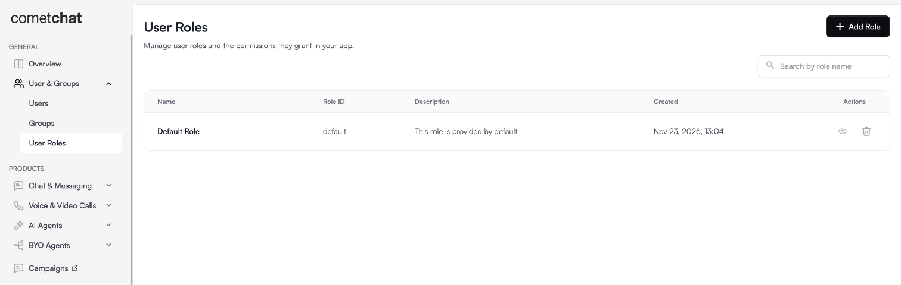
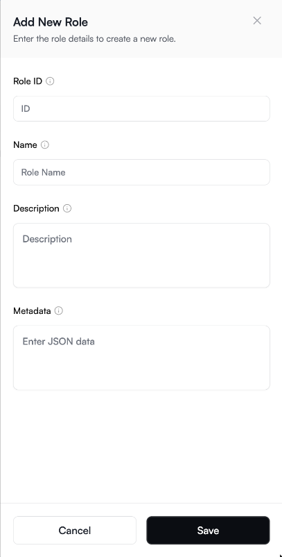
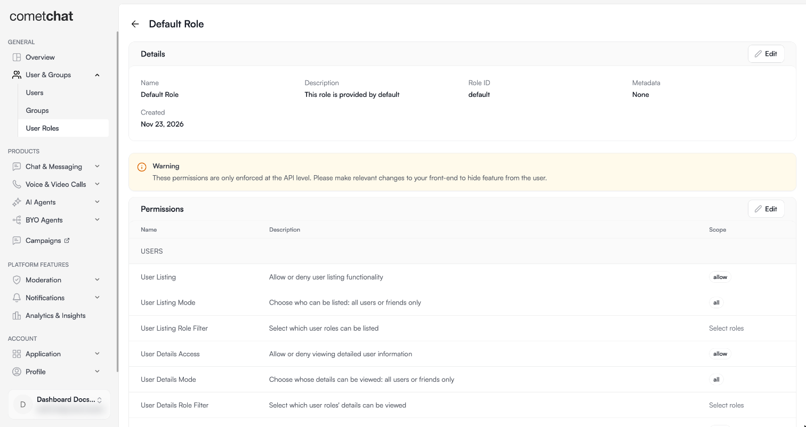

**User Roles** lets you define roles and the permissions they grant across the whole app. Assign a role to a user in [Users](/dashboard/users-groups/users) (**Role** field) or with the API. Every app has a **Default Role** (`default`) that new users get unless you choose another.

**Where:** left navigation → **User & Groups** → **User Roles**.

<Frame>
  
</Frame>

## The role list

Columns: **Name**, **Role ID**, **Description**, **Created**, **Actions**. Use **Search by role name** to filter. The eye icon opens the role; the trash icon deletes it.

## Add a role

Click **Add Role** to open **Add New Role**.

<Frame>
  
</Frame>

| Field | Description |
| --- | --- |
| **Role ID** | Unique identifier of the role. Use it when you assign the role to users. |
| **Name** | Display name of the role. |
| **Description** | Optional description of the role. |
| **Metadata** | Optional additional role data in JSON format. |

Click **Save** to create the role.

## Role permissions

Open a role to see its **Details** (**Name**, **Description**, **Role ID**, **Metadata**, **Created**) and its **Permissions**. Click **Edit** on **Permissions**, change values, and save.

<Frame>
  
</Frame>

<Warning>
These permissions are enforced only at the API level. Also hide the related controls in your front end.
</Warning>

Permissions are **allow**/**deny** toggles, modes (for example **all** users or **friends** only), or filters where you choose roles, receiver types, categories, types, or MIME types.

| Group | Permissions |
| --- | --- |
| **Users** | User Listing, User Listing Mode (all users or friends only), User Listing Role Filter, User Details Access, User Details Mode, User Details Role Filter, Block User, Block User Role Filter, Blocked User Listing, Blocked User Listing Role Filter, Unblock User, Unblock User Role Filter, Edit User Profile |
| **Messages** | Message Listing, Message Listing Mode, Message List Receiver Filter, Message List Sender Filter, Message List Category Filter, Message List Type Filter, Message Details, Message Details Mode, Message Sending, Message Sending Mode, Message Send Receiver Filter, Message Send Role Filter, Message Send Category Filter, Message Send Type Filter, Custom Message Types, MIME Types Access Control, Allowed or Denied MIME Types for Media Uploads, Message Editing, Message Deletion |
| **Message Thread** | Threaded Message Listing, Thread Message Sending, Thread Receiver Type Filter, Thread Role Filter, Thread Category Filter, Thread Type Filter, Thread Custom Types, Thread MIME Types Access Control, Allowed or Denied MIME Types for Thread Uploads, Thread Message Editing, Thread Message Deletion |
| **Message Reactions** | Reaction Listing, Reaction Management |
| **Calls** | Call Initiation, Call Receiver Type Filter, Call Receiver Role Filter, Call Joining |
| **Conversations** | List Conversation, Update Conversation, Delete Conversation |
| **Groups** | Group Listing, Group List Type Filter, Group Details, Group Details Type Filter, Group Creation, Group Creation Type Filter, Group Joining, Group Join Type Filter |
| **Pinned Messages** | Message Pinning, Message Unpinning, Pinned Message Listing |

On the Default Role, toggles default to **allow**, modes to **all**, and filters to no restriction.

## When to use roles

- **Marketplace**: let buyers message only sellers by restricting **Message Send Role Filter**.
- **Social app**: set **User Listing Mode** to friends only so users see only their friends.
- **Support**: give agents a role that can list all users while customers can't.

See [User Roles and Permissions](/fundamentals/user-roles-and-permissions) for concepts and API details.
