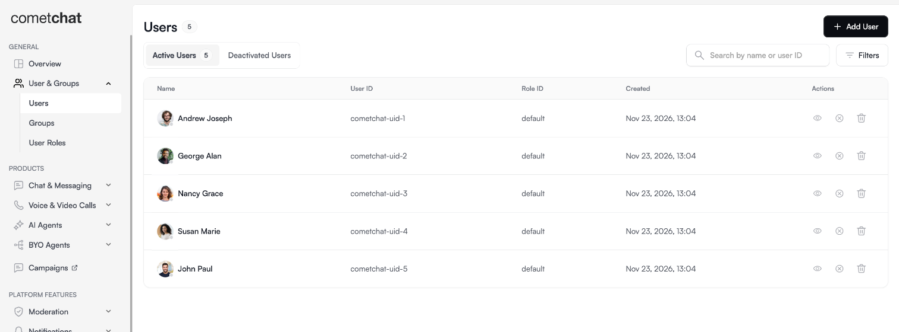
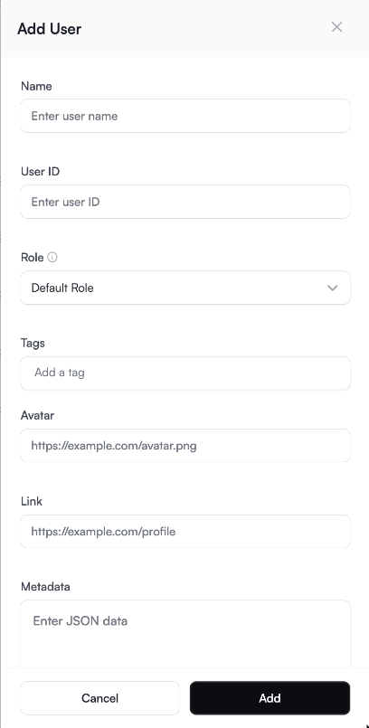
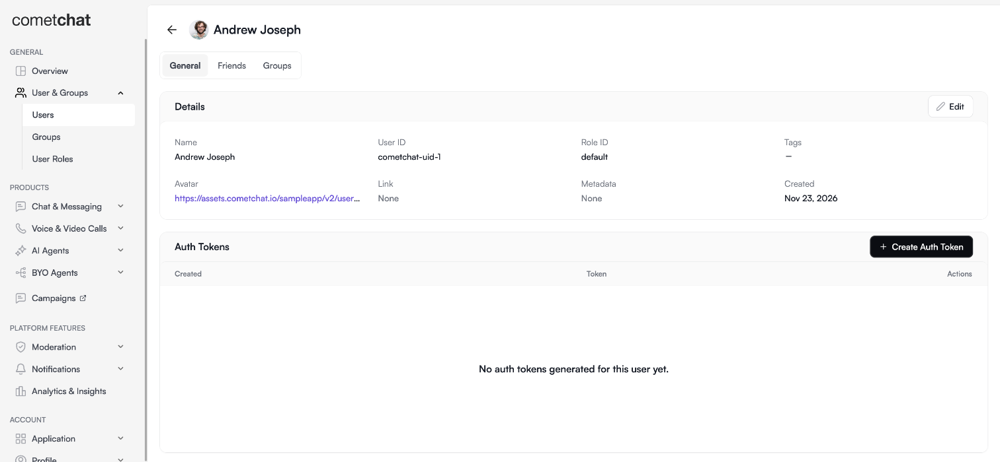

**Users** lists every user in the app. A CometChat user represents a person (or bot) in your product; you normally create users from your backend when someone signs up, but you can also create and edit them here.

**Where:** left navigation → **User & Groups** → **Users**.

<Frame>
  
</Frame>

New apps include five sample users (`cometchat-uid-1` to `cometchat-uid-5`) and a sample group so you can test right away.

## The user list

| Element | Description |
| --- | --- |
| **Active Users** / **Deactivated Users** tabs | Switch between active users and users you have deactivated. The count shows how many users are in each tab. |
| **Search by name or user ID** | Filters the list as you type. |
| **Filters** | Adds filter chips: **UIDs**, **Role**, **Status**, and **Created At Date**. |
| **Columns** | **Name**, **User ID**, **Role ID**, **Created**, **Actions**. |

### Row actions

| Icon | Action |
| --- | --- |
| Eye | **View user**: opens the user detail page. |
| Circle with ✕ | **Deactivate user**: moves the user to **Deactivated Users**. A deactivated user can't log in, but their data is kept. |
| Trash | **Delete user**: permanently deletes the user. |

<Warning>
Deleting a user can't be undone. Deactivate instead if you might need the user again.
</Warning>

## Add a user

Click **Add User** to open the **Add User** panel.

<Frame>
  
</Frame>

| Field | Required | Description |
| --- | --- | --- |
| **Name** | Yes | Display name shown in chat. |
| **User ID** | Yes | Unique identifier (UID) for the user. Use the same ID your own system uses so you can map users. It can't be changed later. |
| **Role** | No | The [user role](/dashboard/users-groups/user-roles) used for role-based access control. Defaults to **Default Role** (`default`). |
| **Tags** | No | Free-form labels. Use them to filter users in the SDK and REST API. |
| **Avatar** | No | Public URL of the profile picture, for example `https://example.com/avatar.png`. |
| **Link** | No | Public URL of the user's profile page. |
| **Metadata** | No | Any extra data as a JSON object. |

Click **Add** to create the user, or **Cancel** to close the panel.

<Tip>
To create users from code, use the [Create User REST API](/rest-api/users) or the SDK `createUser` method. See [User Sync](/fundamentals/user-auth) for the recommended flow.
</Tip>

## User details

Click the eye icon on a row to open the user's page. It has three tabs.

<Frame>
  
</Frame>

### General

**Details** shows the user's **Name**, **User ID**, **Role ID**, **Tags**, **Avatar**, **Link**, **Metadata**, and **Created** date. Click **Edit** to change any field except the User ID.

**Auth Tokens** lists the auth tokens issued to this user (**Created**, **Token**, **Actions**). Click **Create Auth Token** to issue a new token. Use the copy icon to copy a token and the trash icon to revoke it.

<Note>
Auth tokens let a client log in as this user without the Auth Key. In production, generate them from your server with the [Auth Tokens REST API](/rest-api/auth-tokens) rather than from the dashboard.
</Note>

### Friends

Lists the user's friends (**Name**, **UID**, **Actions**). Click **Add Friends** to add friends to the user. Friends matter when [user roles](/dashboard/users-groups/user-roles) restrict listing to friends only.

### Groups

Lists the groups the user belongs to (**Name**, **Group ID**, **Created**, **Actions**). Click **Add Group** to add the user to a group, or the ✕ icon to remove them from one.
