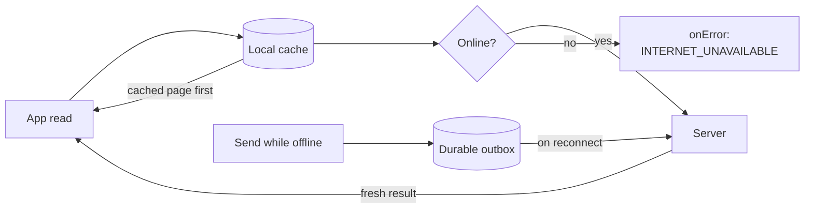

{/* TL;DR for Agents and Quick Reference */}
<Accordion title="AI Integration Quick Reference">

```kotlin
// Offline support is OFF by default. Turn it on at init (minimum SDK 5.1.0).
val offlineConfig = OfflineConfig.Builder()
    .enabled(true)
    .build()

val appSettings = AppSettings.AppSettingsBuilder()
    .setRegion("REGION")
    .setOfflineConfig(offlineConfig)   // or .offline(true) for defaults
    .build()

CometChat.init(context, "APP_ID", appSettings, callbackListener)

// Is offline support active right now for the logged-in user?
val active = CometChat.isOfflineEnabled()   // Boolean
```

</Accordion>

Offline support keeps the logged-in user's conversations and messages on the device so your app can show them instantly, lets the user send messages while disconnected, and catches up automatically when the connection returns. It is **off by default** — nothing changes in your app until you enable it ([Enable Offline Support](/sdk/android/v5/offline-enable)). This page explains the mental model; the other pages show the exact APIs.

<Note>
Offline support requires CometChat Android SDK **5.1.0** or later.
</Note>

## How it works

Three ideas carry the whole feature.

<Steps>
<Step title="Cache first, then server">
Every read goes through the local cache first. The SDK delivers the cached page immediately — even when it is empty — then fetches from the server and delivers the fresh result. Your UI renders what is on the device without waiting for the network, then updates when the server responds. See [Show Cached Data](/sdk/android/v5/offline-cached-data).
</Step>
<Step title="A durable send outbox">
A message sent while offline is saved to a durable outbox and reported as pending instead of failing. It survives app restarts and is sent when the connection returns. See [Send While Offline](/sdk/android/v5/offline-send).
</Step>
<Step title="Catch up on reconnect">
When the device reconnects, the SDK syncs the conversations and messages that changed while it was away and flushes the outbox, so the local cache matches the server again. See [Stay in Sync](/sdk/android/v5/offline-sync).
</Step>
</Steps>



## What changes in your app

With offline support enabled, your fetch and send callbacks fire **twice** on the read path and gain a pending stage on the send path. To receive these cached and pending results you must move to the new listeners — `MessageFetchListener`, `ConversationFetchListener`, `MessageSentListener`, and the others listed on each page. The old `CallbackListener` overloads of the two-phase fetches and sends are deprecated in 5.1.0 but keep working. With offline support off, every API behaves exactly as it did before.

## One cache per user

The SDK keeps a single local cache for the user who is logged in.

- Logging the **same** user back in reuses that cache, so the data is there instantly on next launch.
- Logging out, a session expiring, or logging in as a **different** user wipes the cache. You never clear it yourself — the SDK does it.

See [Stay in Sync](/sdk/android/v5/offline-sync) for cache resets and logout behaviour.

## How much is kept

By default the cache is bounded by size, not age: it holds up to **100 conversations**, up to **500 messages per conversation**, around **250 MB** of data, and up to **500 MB** of cached media. Older entries are evicted first as these limits are reached. Every limit is tunable — see the [Configuration & API Reference](/sdk/android/v5/offline-reference).

## Next steps

<CardGroup cols={2}>
  <Card title="Enable Offline Support" href="/sdk/android/v5/offline-enable">Turn it on and verify it is active.</Card>
  <Card title="Show Cached Data" href="/sdk/android/v5/offline-cached-data">The cached-first, server-next read contract.</Card>
  <Card title="Send While Offline" href="/sdk/android/v5/offline-send">The durable outbox and pending messages.</Card>
  <Card title="Stay in Sync" href="/sdk/android/v5/offline-sync">Reconnect catch-up, cache resets, logout.</Card>
  <Card title="Media Caching" href="/sdk/android/v5/offline-media-caching">Download and cache attachments for offline viewing.</Card>
  <Card title="Encrypt the Cache" href="/sdk/android/v5/offline-encryption">Encrypt the local database at rest.</Card>
  <Card title="Configuration & API Reference" href="/sdk/android/v5/offline-reference">Every option, method, listener, enum, and error.</Card>
</CardGroup>
