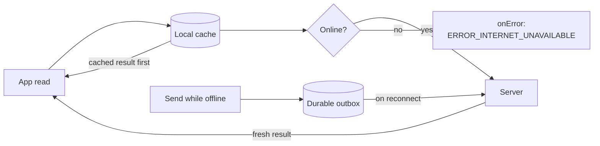

{/* TL;DR for Agents and Quick Reference */}
<Accordion title="AI Integration Quick Reference">

```swift
// Offline support is OFF by default. Turn it on at init (SDK 4.3.0 or later).
let offlineConfig = OfflineConfig.Builder()
    .setEnabled(true)
    .build()

let appSettings = AppSettings.AppSettingsBuilder()
    .setRegion(region: "REGION")
    .setOfflineConfig(offlineConfig)   // or OfflineConfig(enabled: true) for defaults
    .build()

CometChat.init(appId: "APP_ID", appSettings: appSettings, onSuccess: { _ in }, onError: { _ in })

// Is offline support active right now for the logged-in user?
let active = CometChat.isOfflineEnabled()   // Bool
```

</Accordion>

Offline support keeps the logged-in user's conversations and messages on the device so your app can show them instantly, lets the user send messages while disconnected, and catches up automatically when the connection returns. It is **off by default** — nothing changes in your app until you enable it ([Enable Offline Support](/sdk/ios/offline-enable)). This page explains the mental model; the other pages show the exact APIs.

<Note>
Offline support ships in CometChat iOS SDK **4.3.0** or later.
</Note>

## How it works

Three ideas carry the whole feature.

<Steps>
<Step title="Cache first, then server">
Every read goes through the local cache first. The SDK delivers the cached result immediately — even when it is empty — then fetches from the server and delivers the fresh result. Your UI renders what is on the device without waiting for the network, then updates when the server responds. See [Show Cached Data](/sdk/ios/offline-cached-data).
</Step>
<Step title="A durable send outbox">
A message sent while offline is saved to a durable outbox and reported as pending instead of failing. It survives app restarts and is sent, in the order it was composed, when the connection returns. See [Send While Offline](/sdk/ios/offline-send).
</Step>
<Step title="Catch up on reconnect">
When the device reconnects, the SDK syncs the conversations and messages that changed while it was away and flushes the outbox, so the local cache matches the server again. See [Stay in Sync](/sdk/ios/offline-sync).
</Step>
</Steps>



## What changes in your app

With offline support enabled, reads fire **twice** and sends gain a pending stage. To receive these cached and pending results you call the new overloads of the calls you already use:

- Reads: `fetchNext` / `fetchPrevious` with `onCached…`, `onServer…` and `onError` closures, and `getConversation(conversationWith:conversationType:listener:)` with a `ConversationDetailsListener`.
- Sends: `sendTextMessage`, `sendMediaMessage`, `sendCustomMessage` and `sendInteractiveMessage` with `onMessagePending`, `onMessageSent` and `onError` closures.

The existing `onSuccess` / `onError` overloads are unchanged and keep working exactly as before. With offline support off, the new overloads behave like the classic ones: the cached and pending callbacks never fire and the server result arrives in `onServer…` / `onMessageSent`.

## One cache per user

The SDK keeps a single local cache for the user who is logged in.

- Logging the **same** user back in reuses that cache, so the data is there instantly on next launch.
- Logging out, or logging in as a **different** user, deletes the cache and any unsent messages. You never clear it yourself — the SDK does it.

See [Stay in Sync](/sdk/ios/offline-sync) for cache resets and logout behaviour.

## How much is kept

By default the cache is bounded by size, not age: it holds up to **100 conversations**, up to **500 messages per conversation**, around **250 MB** of cached content, and up to **500 MB** of cached media. Older entries are evicted first as these limits are reached. Unsent messages, saved messages and pinned rows are never evicted by these limits. Every limit is tunable — see the [Configuration & API Reference](/sdk/ios/offline-reference).

## Next steps

<CardGroup cols={2}>
  <Card title="Enable Offline Support" href="/sdk/ios/offline-enable">Turn it on and verify it is active.</Card>
  <Card title="Show Cached Data" href="/sdk/ios/offline-cached-data">The cached-first, server-next read contract.</Card>
  <Card title="Send While Offline" href="/sdk/ios/offline-send">The durable outbox and pending messages.</Card>
  <Card title="Stay in Sync" href="/sdk/ios/offline-sync">Reconnect catch-up, cache resets, logout.</Card>
  <Card title="Media Caching" href="/sdk/ios/offline-media-caching">Download and cache attachments for offline viewing.</Card>
  <Card title="Encrypt the Cache" href="/sdk/ios/offline-encryption">Encrypt the local database at rest.</Card>
  <Card title="Configuration & API Reference" href="/sdk/ios/offline-reference">Every option, method, listener, enum, and error.</Card>
</CardGroup>
