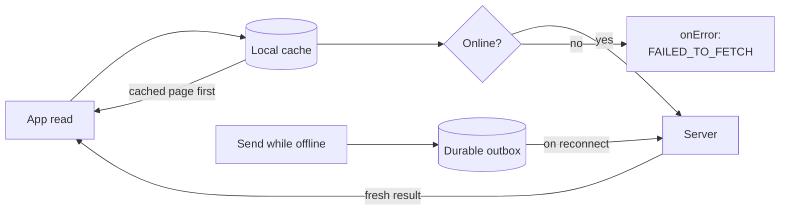

{/* TL;DR for Agents and Quick Reference */}
<Accordion title="AI Integration Quick Reference">

```javascript
// Offline support is OFF by default. Turn it on at init (SDK 4.3.0 or later).
const appSetting = new CometChat.AppSettingsBuilder()
  .setRegion("REGION")
  .setOfflineConfig({ enabled: true })   // or .offline(true) for defaults
  .build();

await CometChat.init("APP_ID", appSetting);

// Is offline support active right now for the logged-in user?
const active = CometChat.isOfflineEnabled();   // boolean
```

</Accordion>

Offline support keeps the logged-in user's conversations and messages on the device so your app can show them instantly, lets the user send messages while disconnected, and catches up automatically when the connection returns. It is **off by default** — nothing changes in your app until you enable it ([Enable Offline Support](/sdk/javascript/offline-enable)). This page explains the mental model; the other pages show the exact APIs.

<Note>
Offline support ships in CometChat JavaScript SDK **4.3.0** or later. It runs in the browser (IndexedDB, with OPFS for media) and in Electron (SQLite). See [Enable Offline Support](/sdk/javascript/offline-enable#supported-runtimes).
</Note>

## How it works

Three ideas carry the whole feature.

<Steps>
<Step title="Cache first, then server">
Reads that you pass a fetch listener go through the local cache first. The SDK delivers the cached page immediately — even when it is empty — then fetches from the server and delivers the fresh result. See [Show Cached Data](/sdk/javascript/offline-cached-data).
</Step>
<Step title="A durable send outbox">
A message sent while offline is saved to a durable outbox and reported as pending instead of failing. It survives page reloads and app restarts and is sent when the connection returns. See [Send While Offline](/sdk/javascript/offline-send).
</Step>
<Step title="Catch up on reconnect">
When the connection returns, the SDK syncs the conversations and messages that changed while it was away and flushes the outbox, so the local cache matches the server again. See [Stay in Sync](/sdk/javascript/offline-sync).
</Step>
</Steps>



## What changes in your app

With offline support enabled, your fetch callbacks fire **twice** on the read path and sends gain a pending stage. To receive the cached and pending results you pass the new listener objects — `MessageFetchListener`, `ConversationFetchListener`, `MessageSentListener`, and the others listed on each page — as an optional argument. Every method still returns its usual Promise, so existing code keeps working. With offline support off, every API behaves exactly as it did before.

## Queued, not failed

A send made with no connection fires `onMessagePending`, then **one** `onError` with code `FAILED_TO_FETCH`, and the returned Promise rejects. That is a notice, not a failure: the message stays queued and `onMessageSent` fires later, on reconnect. See [Send While Offline](/sdk/javascript/offline-send#queued-not-failed).

## One cache per user

The SDK keeps a single local cache per app and user.

- A page reload or app restart with a still-valid session reuses that cache, so the data is there instantly.
- Logging out, a session expiring, or logging in as a **different** user deletes the cache. You never clear it yourself — the SDK does it.

See [Stay in Sync](/sdk/javascript/offline-sync) for cache resets and logout behaviour.

## How much is kept

By default the cache holds up to **100 conversations**, up to **500 messages per conversation**, around **250 MB** of cached content, and up to **500 MB** of cached media. There is no age limit unless you set `cacheDurationDays`. Older entries are evicted first as these limits are reached. Every limit is tunable — see the [Configuration & API Reference](/sdk/javascript/offline-reference).

## Next steps

<CardGroup cols={2}>
  <Card title="Enable Offline Support" href="/sdk/javascript/offline-enable">Turn it on and verify it is active.</Card>
  <Card title="Show Cached Data" href="/sdk/javascript/offline-cached-data">The cached-first, server-next read contract.</Card>
  <Card title="Send While Offline" href="/sdk/javascript/offline-send">The durable outbox and pending messages.</Card>
  <Card title="Stay in Sync" href="/sdk/javascript/offline-sync">Reconnect catch-up, cache resets, logout.</Card>
  <Card title="Media Caching" href="/sdk/javascript/offline-media-caching">Download and cache attachments for offline viewing.</Card>
  <Card title="Encrypt the Cache" href="/sdk/javascript/offline-encryption">Encrypt the local cache at rest.</Card>
  <Card title="Configuration & API Reference" href="/sdk/javascript/offline-reference">Every option, method, listener, enum, and error.</Card>
</CardGroup>
