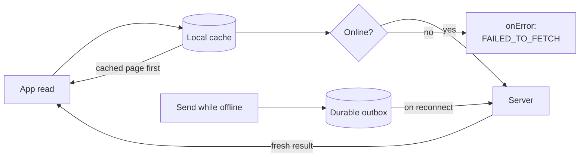

<Accordion title="AI Integration Quick Reference">

| Field | Value |
| --- | --- |
| Package | `@cometchat/chat-sdk-react-native` (4.2.0 or later) |
| Default | **Off.** Enable with `new CometChat.OfflineConfig({ enabled: true })` on `AppSettingsBuilder.setOfflineConfig()` |
| Native peers | `@op-engineering/op-sqlite` (required), `react-native-fs` (media), `react-native-keychain` (encryption) |
| Check it is active | `CometChat.isOfflineEnabled()` |
| Reads | Pass a listener to `fetchNext()` / `fetchPrevious()` — `onCached…` fires first, then `onServer…` |
| Sends | Pass a `MessageSentListener` to `sendMessage()` — `onMessagePending`, then `onMessageSent` or `onError` |
| Related | [Enable](/sdk/react-native/offline-enable) · [Cached data](/sdk/react-native/offline-cached-data) · [Send](/sdk/react-native/offline-send) · [Sync](/sdk/react-native/offline-sync) · [Reference](/sdk/react-native/offline-reference) |

```typescript
const offlineConfig = new CometChat.OfflineConfig({ enabled: true });

const appSettings = new CometChat.AppSettingsBuilder()
  .setRegion("REGION")
  .setOfflineConfig(offlineConfig) // or .offline(true) for defaults
  .build();

await CometChat.init("APP_ID", appSettings);

const active: boolean = CometChat.isOfflineEnabled();
```

</Accordion>

Offline support keeps the logged-in user's conversations and messages on the device so your app can show them instantly, lets the user send messages while disconnected, and catches up automatically when the connection returns. It is **off by default** — nothing changes in your app until you enable it ([Enable Offline Support](/sdk/react-native/offline-enable)). This page explains the mental model; the other pages show the exact APIs.

<Note>
Offline support requires CometChat React Native Chat SDK **4.2.0** or later.
</Note>

## How it works

Three ideas carry the whole feature.

<Steps>
<Step title="Cache first, then server">
Every read that you pass a listener to goes through the local cache first. The SDK delivers the cached page immediately — even when it is empty — then fetches from the server and delivers the fresh result. Your UI renders what is on the device without waiting for the network, then updates when the server responds. See [Show Cached Data](/sdk/react-native/offline-cached-data).
</Step>
<Step title="A durable send outbox">
A message sent while offline is saved to a durable outbox and reported as pending instead of failing. It survives app restarts and is sent when the connection returns. See [Send While Offline](/sdk/react-native/offline-send).
</Step>
<Step title="Catch up on reconnect">
When the device reconnects, the SDK syncs the conversations and messages that changed while it was away and flushes the outbox, so the local cache matches the server again. See [Stay in Sync](/sdk/react-native/offline-sync).
</Step>
</Steps>



## What changes in your app

With offline support enabled, the read and send methods you already call keep working, and gain two things. Reads still return a Promise that settles on the server result; if you also pass a listener, it receives the cached page first and then the server page. Sends still return a Promise; if you also pass a `MessageSentListener`, it is told when the message is queued (`onMessagePending`) and when it is finally sent. To receive the cached and pending stages you must pass these listeners — the Promise-only forms are unchanged. With offline support off, every API behaves exactly as it did before.

## One cache per user

The SDK keeps a single local cache for the user who is logged in, per app.

- Logging the **same** user back in reuses that cache, so the data is there instantly on next launch.
- Logging out, a session expiring, or logging in as a **different** user wipes the cache. You never clear it yourself — the SDK does it.

See [Stay in Sync](/sdk/react-native/offline-sync) for cache resets and logout behaviour.

## How much is kept

By default the cache is bounded by size, not age: it holds up to **100 conversations**, up to **500 messages per conversation**, around **250 MB** of data, and up to **500 MB** of cached media. Older entries are evicted first as these limits are reached. Every limit is tunable — see the [Configuration & API Reference](/sdk/react-native/offline-reference).

## Next steps

<CardGroup cols={2}>
  <Card title="Enable Offline Support" href="/sdk/react-native/offline-enable">Turn it on and verify it is active.</Card>
  <Card title="Show Cached Data" href="/sdk/react-native/offline-cached-data">The cached-first, server-next read contract.</Card>
  <Card title="Send While Offline" href="/sdk/react-native/offline-send">The durable outbox and pending messages.</Card>
  <Card title="Stay in Sync" href="/sdk/react-native/offline-sync">Reconnect catch-up, cache resets, logout.</Card>
  <Card title="Media Caching" href="/sdk/react-native/offline-media-caching">Download and cache attachments for offline viewing.</Card>
  <Card title="Encrypt the Cache" href="/sdk/react-native/offline-encryption">Encrypt the local database at rest.</Card>
  <Card title="Configuration & API Reference" href="/sdk/react-native/offline-reference">Every option, method, listener, enum, and error.</Card>
</CardGroup>
