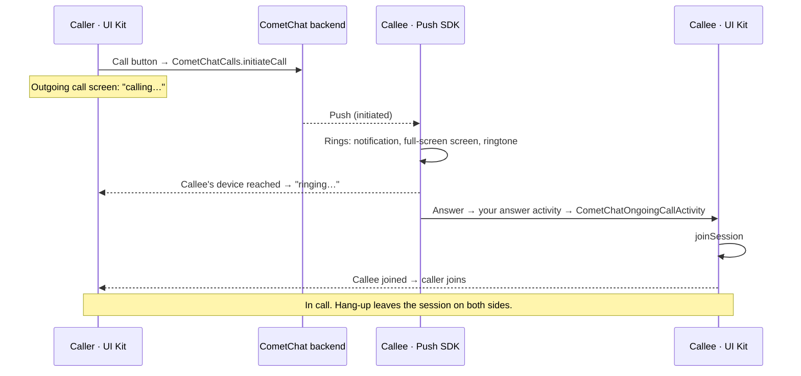

<Accordion title="AI Integration Quick Reference">

| Field | Value |
| --- | --- |
| Kotlin (XML Views) | `com.cometchat:chatuikit-kotlin-android` (brings `calls-sdk-android`); the app adds `push-notifications-android` and `push-notifications-calls-android` |
| Jetpack Compose | `com.cometchat:chatuikit-compose-android` (same: brings `calls-sdk-android`; the app adds both push artifacts) |
| Required setup | `CometChatUIKit.init()` with `setEnableCalling(true)`, `CometChatUIKit.login()`, `CometChatPushNotifications.init()` with `setAnswerActivity(CallAnswerActivity::class.java)` (a small activity that opens `CometChatOngoingCallActivity`), a `FirebaseMessagingService` that calls `handlePushNotification` |
| Incoming calls | Rung by the Push Notifications SDK (notification, full-screen screen, ringtone), in every app state. No call listener, no incoming-call component |
| Call features | Call Buttons, Outgoing Call, Ongoing Call, Call Logs, Call Log Details |
| Key components | `CometChatCallButtons`, `CometChatOutgoingCall`, `CometChatOngoingCall` / `CometChatOngoingCallActivity`, `CometChatCallLogs` |
| Deprecated / superseded | `CometChatIncomingCall` (deprecated, kept for a custom ring screen); Chat SDK `CometChat.addCallListener` / `initiateCall` / `acceptCall` / `rejectCall` / `endCall` (superseded, no longer used) |
| Related | [Calling Integration](/ui-kit/android/calling-integration), [Push Ringing](/calls/android/voip-calling), [Migrating from Legacy Ringing](/calls/android/migrating-from-legacy-ringing), [Call Log Details Guide](/ui-kit/android/guide-call-log-details) |

</Accordion>

CometChat's Calls feature lets you add one-on-one and group audio and video calling to your application. This page is an overview of how calling works in the Android UI Kit and which component handles each part.

## How a call works

- **Placing a call** is done by the UI Kit through the Calls SDK. The Chat SDK is not involved.
- **Ringing the callee** is done by the Push Notifications SDK from the call push. It rings with the app in the foreground, in the background or not running, draws the incoming-call screen, asks for the microphone and camera on Answer, and opens the UI Kit's call screen.
- **Decline, timeout, busy and missed calls** are handled by the Push SDK. The caller's outgoing screen closes with the reason.
- **The call itself** runs in the Calls SDK session hosted by `CometChatOngoingCallActivity`; hanging up leaves the session.

## Integration

Three steps, all on the [Calling Integration](/ui-kit/android/calling-integration) page:

1. `setEnableCalling(true)` in `UIKitSettings`. The UI Kit initialises the Calls SDK and logs the user into it.
2. `CometChatPushNotifications.init()` with `setProviderId` and `setAnswerActivity(CallAnswerActivity::class.java)`, a small answer activity that opens `CometChatOngoingCallActivity`, plus a three-line `FirebaseMessagingService`.
3. `POST_NOTIFICATIONS`, `RECORD_AUDIO` and `CAMERA` in the manifest, and `ensureRingReady` after sign-in.

Once calling is active, the call buttons render in the [MessageHeader](/ui-kit/android/message-header):

<Frame>
  
</Frame>

<Note>
There is no call listener to add. Apps that registered `CometChat.addCallListener` to show `CometChatIncomingCall` should remove it; the Chat SDK's calling APIs are superseded and no longer used. See [Migrating from Legacy Ringing](/calls/android/migrating-from-legacy-ringing).
</Note>

## Call Components

The CometChat Android UI Kit provides these components for calling. Each handles a specific part of the experience.

### Call Buttons

The `CometChatCallButtons` component provides users with quick access to initiate audio and video calls. This component is automatically rendered in the [MessageHeader](/ui-kit/android/message-header) when the Calls SDK is integrated.

<Frame>
  
</Frame>

[Learn more about Call Buttons →](/ui-kit/android/call-buttons)

### Incoming Call

Incoming calls are rung and drawn by the Push Notifications SDK, so there is no UI Kit component to place. Its screen uses the UI Kit's default colours, and follows your own UI Kit theme, light and dark, once you pass it with `setIncomingCallTheme` ([Styling the incoming-call screen](/ui-kit/android/calling-integration#styling-the-incoming-call-screen)). The deprecated `CometChatIncomingCall` component remains for apps that register their own ring screen.

<Frame>
  
</Frame>

[Incoming Call (deprecated) →](/ui-kit/android/incoming-call)

### Outgoing Call

The `CometChatOutgoingCall` component manages the outgoing call experience. It shows "calling…", then "ringing…" once the callee's device is reached, closes with the reason if the call is declined, busy or unanswered, and transitions to the active call screen once the callee joins.

<Frame>
  
</Frame>

[Learn more about Outgoing Call →](/ui-kit/android/outgoing-call)

### Call Logs

The `CometChatCallLogs` component displays a history of all call activities, including missed, received, and dialed calls. Users can view call details and initiate new calls from the log.

<Frame>
  
</Frame>

[Learn more about Call Logs →](/ui-kit/android/call-logs)

### Ongoing Call

The `CometChatOngoingCall` component renders the active call screen with video feeds, mute/unmute controls, camera toggle, and end-call actions. `CometChatOngoingCallActivity` hosts it, supports picture-in-picture, and is the activity the Push SDK opens when the user answers an incoming call.

[Learn more about Ongoing Call →](/ui-kit/android/ongoing-call)

### Call Log Details

For detailed information about individual calls, including participants, join/leave history, and recordings, see the [Call Log Details](/ui-kit/android/guide-call-log-details) guide.
