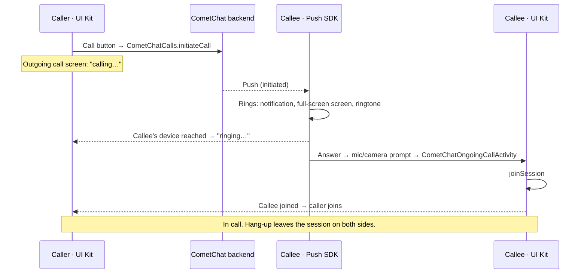

## Overview

With calling enabled, the UI Kit places calls from the message header and call logs, shows the outgoing call screen, and hosts the in-call screen. Incoming calls ring through the CometChat Push Notifications SDK: it shows the call notification and the full-screen incoming-call screen, plays the ringtone, and opens the UI Kit's call screen when the user answers, with the app in the foreground, in the background or not running at all.

<Info>
Make sure you've completed the [Getting Started](/ui-kit/android/getting-started) guide before proceeding.
</Info>



What you write: the UI Kit settings with calling enabled, the Push SDK configuration, a three-line Firebase service, and the manifest permissions. There is no call listener to register and no incoming-call UI to show.

## Step 1: Dependencies

The UI Kit core module depends on the Calls SDK and on both Push Notifications SDK artifacts, so your app gets them transitively. Add the UI Kit module and Firebase Messaging:

<Tabs>
<Tab title="Kotlin (XML Views)">
```kotlin build.gradle.kts
dependencies {
    implementation("com.cometchat:chatuikit-kotlin-android:6.1.0")
    implementation(platform("com.google.firebase:firebase-bom:33.7.0"))
    implementation("com.google.firebase:firebase-messaging")
}
```
</Tab>

<Tab title="Jetpack Compose">
```kotlin build.gradle.kts
dependencies {
    implementation("com.cometchat:chatuikit-compose-android:6.1.0")
    implementation(platform("com.google.firebase:firebase-bom:33.7.0"))
    implementation("com.google.firebase:firebase-messaging")
}
```
</Tab>
</Tabs>

Apply the `google-services` plugin and put `google-services.json` in the app module. `minSdk` must be 26 or higher: the Calls SDK's React Native runtime declares it.

<Note>
To pin the SDK versions yourself, declare them explicitly; the UI Kit requires `calls-sdk-android` 5.1 or newer and `push-notifications-android` / `push-notifications-calls-android` 2.0 or newer.
</Note>

## Step 2: Enable calling in the UI Kit

Set `setEnableCalling(true)` in `UIKitSettings`. `CometChatUIKit.init` then initialises the Calls SDK with the same app id, region and hosts, and `CometChatUIKit.login` logs the user into it. Do not call `CometChatCalls.init` yourself: the Calls SDK keeps the hosts of its first initialisation.

<Tabs>
<Tab title="Kotlin (XML Views)">
```kotlin
val settings = UIKitSettings.UIKitSettingsBuilder()
    .setAppId(APP_ID)
    .setRegion(REGION)
    .setAuthKey(AUTH_KEY)
    .subscribePresenceForAllUsers()
    .setEnableCalling(true)
    .build()

CometChatUIKit.init(this, settings, object : CometChat.CallbackListener<String>() {
    override fun onSuccess(result: String) { initPushNotifications() }
    override fun onError(e: CometChatException) { Log.e(TAG, "init failed: ${e.message}") }
})
```
</Tab>
<Tab title="Jetpack Compose">
```kotlin
val settings = UIKitSettings.UIKitSettingsBuilder()
    .setAppId(APP_ID)
    .setRegion(REGION)
    .setAuthKey(AUTH_KEY)
    .subscribePresenceForAllUsers()
    .setEnableCalling(true)
    .build()

CometChatUIKit.init(this, settings, object : CometChat.CallbackListener<String>() {
    override fun onSuccess(result: String) { initPushNotifications() }
    override fun onError(e: CometChatException) { Log.e(TAG, "init failed: ${e.message}") }
})
```
</Tab>
</Tabs>

Run this in `Application.onCreate` from stored credentials, not only after a screen opens. A push can start the app process to ring a call, and the answer must find a ready SDK.

<Warning>
**Enabling calling in an app that already has logged-in users requires a re-login.** `CometChatUIKit.login()` short-circuits when the same uid already has a persisted session, so the Calls SDK never logs in: the Calls SDK has no auth token and `CometChatCallLogs` shows a silent error state (logcat: `User auth token cannot be null`). After calling is first enabled, log out and log in again (`CometChatUIKit.logout(...)` then `CometChatUIKit.login(...)`), and wire `onError` on `CometChatCallLogs` during development so this failure is visible.
</Warning>

### Staging or dedicated deployments

Pass all three hosts; the UI Kit forwards them to the Chat SDK and the Calls SDK. The Push SDK gets the client host in the next step.

```kotlin
UIKitSettings.UIKitSettingsBuilder()
    .setAppId(APP_ID).setRegion(REGION).setAuthKey(AUTH_KEY)
    .overrideAdminHost("$APP_ID.api-$REGION.example.com/v3")
    .overrideClientHost("$APP_ID.apiclient-$REGION.example.com/v3")
    .overrideCallsHost("$APP_ID.call-$REGION.example.com/v3")
    .setEnableCalling(true)
    .build()
```

## Step 3: Configure push ringing

Initialise the Push Notifications SDK once, after the UI Kit (the FCM provider id and the answer activity are all it needs). `CometChatOngoingCallActivity` is the UI Kit's in-call screen; registered as the answer activity it reads the answered call from its intent and joins.

<Tabs>
<Tab title="Kotlin (XML Views)">
```kotlin
import com.cometchat.uikit.kotlin.presentation.ongoingcall.ui.CometChatOngoingCallActivity

private fun initPushNotifications() {
    val config = PNConfiguration.Builder(APP_ID, REGION)
        .setProviderId(PROVIDER_ID)                                   // FCM provider id from the dashboard
        .setAnswerActivity(CometChatOngoingCallActivity::class.java)  // the UI Kit's call screen
        .setNotificationSmallIcon(R.drawable.ic_notification)
        .apply {
            // Same host as the Chat and Calls SDKs, or the token registers on the wrong app
            CometChatUIKit.getAuthSettings()?.overrideClientHost?.let { overrideClientHost(it) }
        }
        .build()
    CometChatPushNotifications.init(this, config)
}
```
</Tab>
<Tab title="Jetpack Compose">
```kotlin
import com.cometchat.uikit.compose.presentation.ongoingcall.ui.CometChatOngoingCallActivity

private fun initPushNotifications() {
    val config = PNConfiguration.Builder(APP_ID, REGION)
        .setProviderId(PROVIDER_ID)                                   // FCM provider id from the dashboard
        .setAnswerActivity(CometChatOngoingCallActivity::class.java)  // the UI Kit's call screen
        .setNotificationSmallIcon(R.drawable.ic_notification)
        .apply {
            // Same host as the Chat and Calls SDKs, or the token registers on the wrong app
            CometChatUIKit.getAuthSettings()?.overrideClientHost?.let { overrideClientHost(it) }
        }
        .build()
    CometChatPushNotifications.init(this, config)
}
```
</Tab>
</Tabs>

Then hand every push to the SDK from your Firebase service:

```kotlin
class AppFCMService : FirebaseMessagingService() {
    override fun onMessageReceived(message: RemoteMessage) {
        CometChatPushNotifications.handlePushNotification(this, message.data, message.sentTime)
    }
    override fun onNewToken(token: String) {
        CometChatPushNotifications.handleTokenRefresh(token)
    }
}
```

```xml AndroidManifest.xml
<service android:name=".AppFCMService" android:exported="false">
    <intent-filter>
        <action android:name="com.google.firebase.MESSAGING_EVENT" />
    </intent-filter>
</service>
```

The push token is registered on login and unregistered on logout by the SDK. Do not skip call pushes when the app is in the foreground: the push is the only incoming-call signal, in every app state. Call pushes must be sent at high FCM priority.

Every option of `PNConfiguration` (ring timeout, missed-call notifications, your own ring screen, MANUAL mode) is on the Calls SDK's [Push Ringing](/calls/android/voip-calling) page.

## Step 4: Permissions

```xml AndroidManifest.xml
<uses-permission android:name="android.permission.POST_NOTIFICATIONS" />
<uses-permission android:name="android.permission.RECORD_AUDIO" />
<uses-permission android:name="android.permission.CAMERA" />
```

The remaining permissions and components (full-screen intent, the ringing foreground service, the ring screen) come from the Push SDK's manifest.

At runtime:

- **Notifications**: ask for `POST_NOTIFICATIONS` (Android 13+) after sign-in, then call `CometChatPushNotifications.ensureRingReady(activity)` and show the user anything other than `READY`. Notifications off, a muted call channel, a revoked full-screen intent and Do Not Disturb all silence calls with no error.
- **Microphone and camera**: the Push SDK asks when the user answers, and the UI Kit's call screen asks once more when it opens; a denied microphone joins muted. Ask at sign-in as well if you do not want the first call to be where the user meets the prompt.

```kotlin
CometChatPushNotifications.ensureRingReady(this) { result ->
    val readiness = result.valueOrNull() ?: return@ensureRingReady
    if (readiness != RingReadiness.READY) {
        Toast.makeText(this, "Incoming calls may not ring: $readiness", Toast.LENGTH_LONG).show()
    }
}
```

Run `ensureRingReady` only after your own permission request has returned; Android drops a request made while another dialog is open.

## Step 5: Log out through the UI Kit

```kotlin
CometChatUIKit.logout(object : CometChat.CallbackListener<String>() {
    override fun onSuccess(s: String) { /* go to login */ }
    override fun onError(e: CometChatException) { }
})
```

`CometChatUIKit.logout` ends a call in progress, cancels an outgoing call still ringing, then logs out of the Chat SDK and the Calls SDK; the Push SDK stops a ring still playing for the old user and unregisters the token. `CometChat.logout` alone does none of the calling clean-up.

## What the UI Kit does from here

Once calling is active, the voice and video call buttons render in the [MessageHeader](/ui-kit/android/message-header):

<Tabs>
<Tab title="Kotlin (XML Views)">
The call buttons appear automatically — `CometChatMessageHeader` detects that calling is enabled, so no extra code is needed.
</Tab>

<Tab title="Jetpack Compose">
The `CometChatMessageHeader` composable hides the call buttons by default (`hideVoiceCallButton` and `hideVideoCallButton` both default to `true`). Show them explicitly:

```kotlin
CometChatMessageHeader(
    user = user,
    hideVoiceCallButton = false,
    hideVideoCallButton = false
)
```
</Tab>
</Tabs>

<Frame>
  
</Frame>

| Moment | What happens | Component |
|--------|--------------|-----------|
| Tap a call button | `CometChatCalls.initiateCall`, then the outgoing screen opens | [Call Buttons](/ui-kit/android/call-buttons) |
| Waiting | "calling…", then "ringing…" when the callee's device is reached; End cancels the call; 45 s with no answer ends it as unanswered | [Outgoing Call](/ui-kit/android/outgoing-call) |
| Callee declines / is busy / does not answer | The outgoing screen closes with the reason | Outgoing Call |
| Incoming call | The Push SDK rings and draws the incoming-call screen | Push SDK (no UI Kit component) |
| Answer | `CometChatOngoingCallActivity` opens and joins the session | [Ongoing Call](/ui-kit/android/ongoing-call) |
| Hang-up | The session is left; the other side's screen closes | Ongoing Call |
| Call history | Call logs list from the Calls SDK; the call icon calls back | [Call Logs](/ui-kit/android/call-logs) |
| Group call | The group call button sends a meeting message; tapping it joins the conference | Call Buttons, Ongoing Call |

To react to calls in your own code (a badge, analytics, refreshing a screen), listen on the Calls SDK with `CometChatCalls.addIncomingCallListener`, the same callback the UI Kit uses internally. Do not use the Chat SDK's `CallListener`; it is superseded and fires nothing in this flow.

## Placing a call from your own screen

```kotlin
lifecycleScope.launch {
    CallInitiationUtils.initiateUserCall(user.uid, CometChatConstants.CALL_TYPE_AUDIO, user)
        .onSuccess { call -> CometChatCallActivity.launchOutgoingCallScreen(context, call, null) }
        .onFailure { e -> Log.e(TAG, "Could not start the call: ${e.message}") }
}
```

`CometChatCallActivity` is `com.cometchat.uikit.kotlin.calls.CometChatCallActivity` for XML Views and `com.cometchat.uikit.compose.calls.CometChatCallActivity` for Compose. A call is refused with `ACTIVE_CALL` while another session is active.

## Styling the incoming-call screen

The incoming-call screen belongs to the Push SDK and is themed by resources, not by the UI Kit theme. The UI Kit ships overrides for the six colour resources so the screen matches its light and dark palette; your app's own override wins:

```xml res/values/colors.xml
<color name="cometchat_pn_call_background">#FFFFFF</color>
<color name="cometchat_pn_call_text">#141414</color>
<color name="cometchat_pn_call_text_secondary">#727272</color>
<color name="cometchat_pn_call_avatar">#6852D6</color>
<color name="cometchat_pn_call_accept">#09C26F</color>
<color name="cometchat_pn_call_decline">#F44649</color>
```

Strings, drawables, the theme and the layout can be overridden the same way; the full list is under [Theming the SDK's incoming-call screen](/calls/android/voip-calling#theming-the-sdks-incoming-call-screen). To draw the screen yourself, register the UI Kit's `CometChatCallActivity` or your own activity with `setIncomingCallActivity`; see the deprecated [Incoming Call](/ui-kit/android/incoming-call) component.

## Upgrading from an app that used `CometChat.addCallListener`

Enable the **ringing migration** setting for your app in the CometChat dashboard. Then remove the Application-level `CallListener`, the incoming-call overlay or `launchIncomingCallScreen` call, any ringtone you played, the busy check, and the Push SDK 1.0 `setVoIPEnabled` / `setOnCallAnsweredHandler` wiring, and follow the steps above. The method-by-method mapping is on [Migrating from Legacy Ringing](/calls/android/migrating-from-legacy-ringing).
