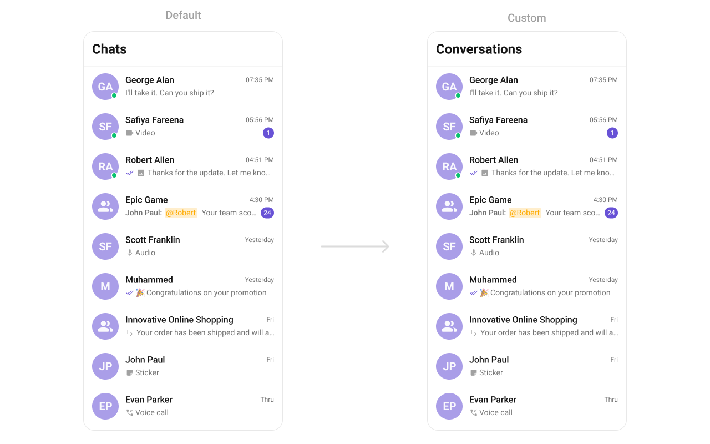

<Accordion title="AI Integration Quick Reference">

| Field | Value |
| --- | --- |
| Import | `com.cometchat.uikit.core.resources.localise.CometChatLocalize` |
| Set language | `CometChatLocalize.setLocale(context, Language.FRENCH)` |
| Get language | `CometChatLocalize.getLocale(context)` |
| Supported languages | 19: ar, de, en, es, fr, hi, hu, it, ja, ko, lt, ms, nl, pl, pt, ru, sv, tr, zh |
| Override labels | `res/values/strings.xml` — override UI Kit string resource keys |
| Layout direction | Separate from the language. See [RTL Support](/ui-kit/android/rtl-support) |
| Related | [Theme Introduction](/ui-kit/android/theme-introduction) · [Sound Manager](/ui-kit/android/sound-manager) · [RTL Support](/ui-kit/android/rtl-support) |

</Accordion>

Set the CometChat UI Kit language and override UI text so your app matches your users' locale.

---

## Core Concepts

- `CometChatLocalize` — utility object in `chatuikit-core` to set and read the UI Kit locale. Shared by both Kotlin XML and Jetpack Compose modules.
- `Language` — constants for supported language codes (`Language.ENGLISH`, `Language.FRENCH`, etc.)
- `strings.xml` — Android string resources that control visible text in UI Kit components. Override keys in your app's `strings.xml`.

### Supported Languages

| Language | Code | Language | Code |
| --- | --- | --- | --- |
| Arabic | `ar` | Korean | `ko` |
| Chinese | `zh` | Lithuanian | `lt` |
| Dutch | `nl` | Malay | `ms` |
| English | `en` | Polish | `pl` |
| French | `fr` | Portuguese | `pt` |
| German | `de` | Russian | `ru` |
| Hindi | `hi` | Spanish | `es` |
| Hungarian | `hu` | Swedish | `sv` |
| Italian | `it` | Turkish | `tr` |
| Japanese | `ja` | | |

---

## Set the UI Kit Locale

Call `CometChatLocalize.setLocale()` before rendering any UI Kit components.

<Note>
`setLocale` changes the UI Kit's language only, not its layout direction. To show Arabic right to left, set the app's language with `AppCompatDelegate.setApplicationLocales`, or set the UI Kit's direction. See [RTL Support](/ui-kit/android/rtl-support).
</Note>

<Tabs>
<Tab title="Kotlin (XML Views)">

```kotlin lines
import com.cometchat.uikit.core.resources.localise.CometChatLocalize
import com.cometchat.uikit.core.resources.localise.Language

// Set language to Hindi
CometChatLocalize.setLocale(this, Language.HINDI)

// Read current locale
val currentLocale = CometChatLocalize.getLocale(this)
```

</Tab>
<Tab title="Jetpack Compose">

```kotlin lines
import com.cometchat.uikit.core.resources.localise.CometChatLocalize
import com.cometchat.uikit.core.resources.localise.Language

// Set language before setContent {}
CometChatLocalize.setLocale(this, Language.HINDI)

setContent {
    CometChatTheme {
        // UI Kit composables will use Hindi strings
        CometChatConversations(...)
    }
}
```

</Tab>
</Tabs>

---

## Override UI Kit Labels

Override any UI Kit string by adding the same key to your app's `res/values/strings.xml`. No source code changes needed — Android's resource merging handles it.

```xml res/values/strings.xml lines
<resources>
    <!-- Override the conversations list title -->
    <string name="cometchat_chats" translatable="true">Conversations</string>

    <!-- Override the "typing" indicator text -->
    <string name="cometchat_typing" translatable="true">writing...</string>
</resources>
```

<Frame>
  
</Frame>

This works identically for both Kotlin XML Views and Jetpack Compose — both modules read from the same Android string resources.

The texts that [offline support](/ui-kit/android/offline-support) shows, such as "Connect to load chats", "Not sent yet" and "Jump to latest", are listed with their keys in [Offline states and texts](/ui-kit/android/offline-support#offline-states-and-texts). Override them the same way.

### Group Action Messages

*Available since v6.3.1*

The UI Kit writes the lines for group member actions, such as "Andrew added George" or "Andrew made George admin", in the UI Kit's language. The same line shows in the message list, the conversation's last-message preview and search results. When the logged-in user is the one acting, the line says "You" ("You added George"); when they are the member acted on, it says "you" ("Andrew added you").

Each line is a whole sentence with numbered placeholders, so a translation can put the names in any order. Override the keys the same way as other labels:

| Action | Someone else | The logged-in user acts | The logged-in user is acted on |
| --- | --- | --- | --- |
| Joined | `cometchat_group_action_joined` | `cometchat_group_action_you_joined` | — |
| Left | `cometchat_group_action_left` | `cometchat_group_action_you_left` | — |
| Added | `cometchat_group_action_added` | `cometchat_group_action_you_added` | `cometchat_group_action_added_you` |
| Removed | `cometchat_group_action_kicked` | `cometchat_group_action_you_kicked` | `cometchat_group_action_kicked_you` |
| Banned | `cometchat_group_action_banned` | `cometchat_group_action_you_banned` | `cometchat_group_action_banned_you` |
| Unbanned | `cometchat_group_action_unbanned` | `cometchat_group_action_you_unbanned` | `cometchat_group_action_unbanned_you` |
| Made admin | `cometchat_group_action_made_admin` | `cometchat_group_action_you_made_admin` | `cometchat_group_action_made_you_admin` |
| Made moderator | `cometchat_group_action_made_moderator` | `cometchat_group_action_you_made_moderator` | `cometchat_group_action_made_you_moderator` |
| Made participant | `cometchat_group_action_made_participant` | `cometchat_group_action_you_made_participant` | `cometchat_group_action_made_you_participant` |

```xml res/values/strings.xml lines
<resources>
    <!-- %1$s is the member who acted, %2$s the member acted on -->
    <string name="cometchat_group_action_added" translatable="true">%1$s invited %2$s</string>
</resources>
```

If a name the line needs is missing, the UI Kit shows the text the server sent with the action instead.

---

## Customize Date & Time Labels

Override how timestamps like "Today", "Yesterday", and "X mins ago" are displayed.

<Tabs>
<Tab title="Kotlin (XML Views)">

Set a `DateTimeFormatterCallback` on individual components:

```kotlin lines
import com.cometchat.uikit.kotlin.shared.interfaces.DateTimeFormatterCallback
import java.text.SimpleDateFormat
import java.util.Date
import java.util.Locale

val messageList = findViewById<CometChatMessageList>(R.id.message_list)

messageList.setDateTimeFormatter(object : DateTimeFormatterCallback {
    private val dateFormatter = SimpleDateFormat("dd MMM yyyy", Locale.getDefault())

    override fun time(timestamp: Long): String = SimpleDateFormat("hh:mm a", Locale.getDefault()).format(Date(timestamp))
    override fun today(timestamp: Long): String = "Today"
    override fun yesterday(timestamp: Long): String = "Yesterday"
    override fun lastWeek(timestamp: Long): String = "Last Week"
    override fun otherDays(timestamp: Long): String = dateFormatter.format(Date(timestamp))
    override fun minutes(diffInMinutesFromNow: Long, timestamp: Long): String = "$diffInMinutesFromNow mins ago"
    override fun hours(diffInHourFromNow: Long, timestamp: Long): String = "$diffInHourFromNow hrs ago"
})
```

</Tab>
<Tab title="Jetpack Compose">

Pass a `dateTimeFormatter` parameter to the component:

```kotlin lines
CometChatMessageList(
    user = user,
    dateTimeFormatter = object : DateTimeFormatterCallback {
        override fun time(timestamp: Long): String = SimpleDateFormat("hh:mm a", Locale.getDefault()).format(Date(timestamp))
        override fun today(timestamp: Long): String = "Today"
        override fun yesterday(timestamp: Long): String = "Yesterday"
        override fun lastWeek(timestamp: Long): String = "Last Week"
        override fun otherDays(timestamp: Long): String = SimpleDateFormat("dd MMM yyyy", Locale.getDefault()).format(Date(timestamp))
        override fun minutes(diffInMinutesFromNow: Long, timestamp: Long): String = "$diffInMinutesFromNow mins ago"
        override fun hours(diffInHourFromNow: Long, timestamp: Long): String = "$diffInHourFromNow hrs ago"
    }
)
```

</Tab>
</Tabs>

---

## Additional API

| Method | Description |
| --- | --- |
| `CometChatLocalize.setLocale(context, language)` | Sets the UI Kit language |
| `CometChatLocalize.getLocale(context)` | Returns the current locale country code |
| `CometChatLocalize.getLanguage(context)` | Returns the current locale language code |
| `CometChatLocalize.isRtl(context)` | *Deprecated in v6.3.1.* Reports whether the app's configuration is right to left, not the UI Kit's direction. Read `view.layoutDirection` or `LocalLayoutDirection.current` instead. See [RTL Support](/ui-kit/android/rtl-support) |
| `CometChatLocalize.resetToDefault()` | Resets locale to system default |
| `CometChatLocalize.createLocalizedContext(context, language)` | Creates a context with a specific locale without affecting the app globally |
