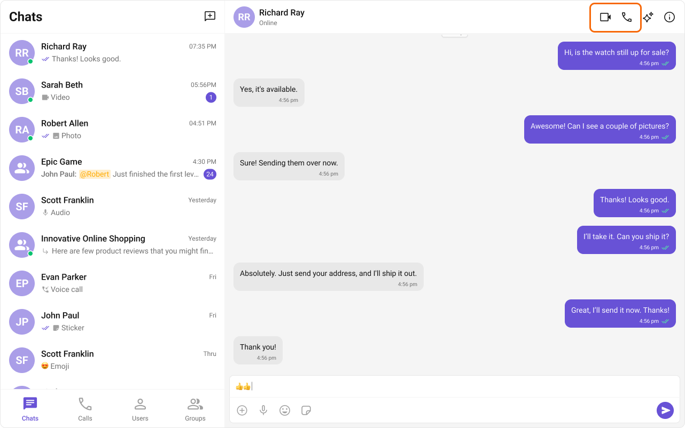
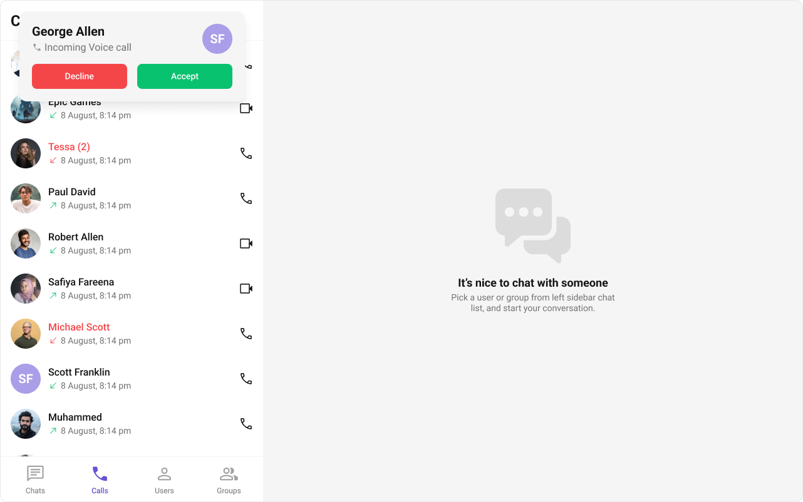
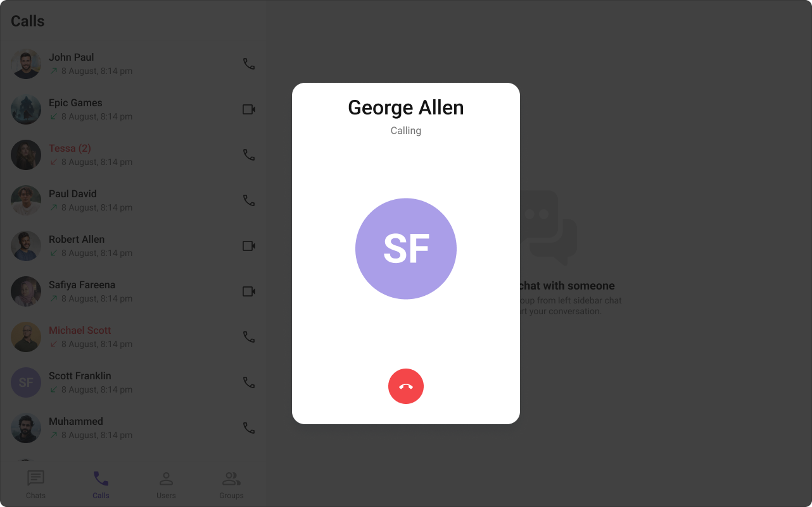
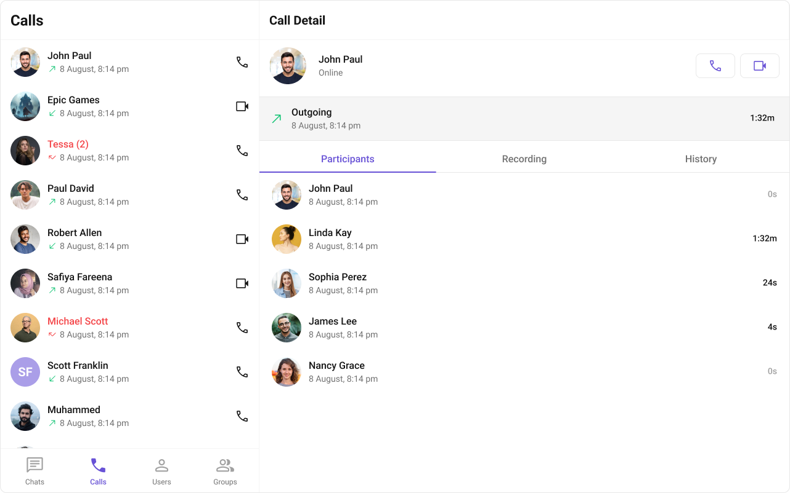

## Overview

CometChat Calls integrates 1:1 and group audio/video calling into the Angular UIKit. Install the Calls SDK and the UIKit auto-detects it, enabling call components.

<Note>
Ensure `CometChatUIKit.init()` has completed and the user is logged in before using call features.
</Note>

## Integration

Install the Calls SDK:

{/* TODO(release): the first Calls SDK release with the fix the UI Kit needs. */}
```bash
npm install @cometchat/calls-sdk-javascript@^5.1.1
```

<Note>
1:1 calls need the Calls SDK 5.1.1 or later. On 5.0.x, every 1:1 call fails with the error `CALLS_SDK_UNAVAILABLE`.
</Note>

Then enable calling in your `UIKitSettingsBuilder`:

```typescript
const settings = new UIKitSettingsBuilder()
  .setAppId('APP_ID')
  .setRegion('REGION')
  .setAuthKey('AUTH_KEY')
  .setCallingEnabled(true)
  .build();
```

<Warning>
  Both steps are required. Installing the Calls SDK alone is not enough — you must also call `.setCallingEnabled(true)` on the builder. Without it, call buttons remain hidden and the Calls SDK is not initialized.
</Warning>

When enabled, [cometchat-call-buttons](/ui-kit/angular/components/cometchat-call-buttons) renders in [cometchat-message-header](/ui-kit/angular/components/cometchat-message-header) and the trailing call button appears in [cometchat-call-logs](/ui-kit/angular/components/cometchat-call-logs).

### Add the incoming call card and the call host

Put [cometchat-incoming-call](/ui-kit/angular/components/cometchat-incoming-call) and [cometchat-call-host](/ui-kit/angular/components/cometchat-call-host) once in your root component, next to the router outlet:

```html
<router-outlet />
<cometchat-incoming-call></cometchat-incoming-call>
<cometchat-call-host></cometchat-call-host>
```

The incoming call card rings for calls to the logged-in user. The call host draws the screens of every call, so a call carries on when the user opens another chat. Without it, the call buttons draw the screens themselves, and a call ends when the call buttons that placed it are destroyed.

### Custom Call App Settings

By default the UIKit builds `CallAppSettings` from your `appId` and `region`. If you need custom configuration (e.g. a different region for the Calls SDK or additional settings), pass your own `CallAppSettings`:

```typescript
import { CometChatUIKitCalls } from '@cometchat/calls-sdk-javascript';

const callAppSettings = new CometChatUIKitCalls.CallAppSettingsBuilder()
  .setAppId('APP_ID')
  .setRegion('REGION')
  .build();

const settings = new UIKitSettingsBuilder()
  .setAppId('APP_ID')
  .setRegion('REGION')
  .setAuthKey('AUTH_KEY')
  .setCallingEnabled(true)
  .setCallAppSettings(callAppSettings)
  .build();
```

<Info>
  `setCallAppSettings` is optional. When omitted, the UIKit automatically creates settings from the `appId` and `region` you already provided.
</Info>

<Frame>
  
</Frame>

## How calls ring

1:1 calls ring through the Calls SDK, on its [ringing flow](/calls/javascript/ringing). The kit places, answers, declines and cancels them, so the app writes no ringing code:

- The caller's screen reads "Calling...", then "Ringing..." once the callee's device rings.
- The callee sees the [cometchat-incoming-call](/ui-kit/angular/components/cometchat-incoming-call) card. When one of the callee's tabs or devices answers or declines, the others stop ringing.
- If nobody answers within 45 seconds, the caller's kit ends the call as unanswered.
- A tab that is already in a call, placing one or showing an incoming call answers a new 1:1 call busy, without showing it.

Group calls that the kit places don't ring. The kit sends a meeting message to the group, and members join the call from it.

### The Connect legacy ringing setting

**Connect legacy ringing**, in the dashboard under **Voice & Video Calls → Settings**, also sends calls on this flow as legacy call events. Turn it on while some of your users are on apps on legacy ringing, such as an older UI Kit or a mobile app that doesn't ring with the Calls SDK 5.1 and the Push Notifications SDK 2.0; see [While some users are still on legacy ringing](/calls/javascript/migrating-from-legacy-ringing#while-some-users-are-still-on-legacy-ringing). While it's off:

- An app on legacy ringing that is called keeps ringing after the caller cancels.
- A decline, a cancel or no answer shows on the other side a few seconds late. The kit learns of it by reading the call's status every 3 seconds while the call rings, and from the call's messages once it ends.

## Features

### Incoming Call

The [cometchat-incoming-call](/ui-kit/angular/components/cometchat-incoming-call) component displays a call screen when a call is received, showing caller info with accept/reject options.

<Frame>
  
</Frame>

### Outgoing Call

The [cometchat-outgoing-call](/ui-kit/angular/components/cometchat-outgoing-call) component displays an outgoing call screen with recipient info and call status. Transitions to the ongoing call screen when the receiver accepts.

<Frame>
  
</Frame>

### Call Logs

The [cometchat-call-logs](/ui-kit/angular/components/cometchat-call-logs) component displays call history — caller, time, and duration.

<Frame>
  
</Frame>

## Next Steps

<CardGroup cols={2}>
  <Card title="Call Buttons" icon="phone-flip" href="/ui-kit/angular/components/cometchat-call-buttons">
    Audio and video call buttons
  </Card>
  <Card title="Incoming Call" icon="phone-arrow-down-left" href="/ui-kit/angular/components/cometchat-incoming-call">
    Incoming call notifications and UI
  </Card>
  <Card title="Call Logs" icon="clock-rotate-left" href="/ui-kit/angular/components/cometchat-call-logs">
    Call history and details
  </Card>
  <Card title="Core Features" icon="comments" href="/ui-kit/angular/core-features">
    Core chat features
  </Card>
</CardGroup>
