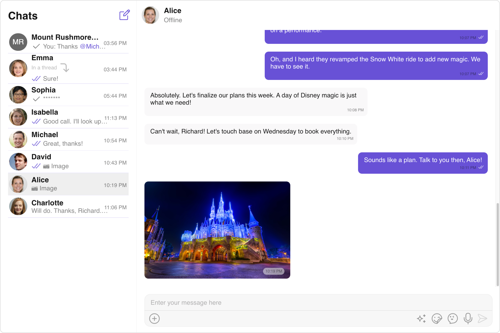

import BuildWithAIUpgrade from '/snippets/ai/build-with-ai-upgrade.mdx';

<Note>
🚀 **CometChat Angular UI Kit v5 is now available!** It features a completely revamped component architecture, standalone components, CSS variable theming, and improved customization. [Switch to v5 →](/ui-kit/angular/overview)
</Note>

<Accordion title="AI Integration Quick Reference">

| Field | Value |
| --- | --- |
| Package | `@cometchat/chat-uikit-angular` |
| Peer deps | `@cometchat/uikit-elements`, `@cometchat/uikit-resources`, `@cometchat/uikit-shared` |
| Source | [GitHub](https://github.com/cometchat-pro/cometchat-chat-sample-app-angular/tree/v4) |
| AI Skills | `npx @cometchat/skills add` (targets v5; ask it to upgrade from v4) — [Agent Skills](/agent-skills) |

</Accordion>

CometChat's **UI Kit** for Angular, you can effortlessly build a chat app equipped with all the essential messaging features, along with customizable options tailored to your application requirements. This **UI Kit** comprises prebuilt UI components organized into smaller modules and components, each configurable to meet your specific needs.

<Frame>
  
</Frame>
--------

[Angular Sample App](https://github.com/cometchat-pro/cometchat-chat-sample-app-angular/tree/v4)

##### **Before Getting Started**

Before you begin, it's essential to grasp the fundamental concepts and features offered by CometChat's APIs, SDK, and UI Kit. You can find detailed information in [Key Concepts](/fundamentals/key-concepts) documentation.

The Angular UI Kit offers pre-built components for easy integration into Angular applications, built on top of the [JavaScript Chat SDK](/sdk/javascript/overview) Installing it also includes the core SDK functionalities.

To begin, please follow the [Getting Started](/ui-kit/angular/v4/getting-started) guide.

---

## Build with AI

<BuildWithAIUpgrade kit="Angular UI Kit" version="v4" current="v5" currentHref="/ui-kit/angular/overview" prompt="upgrade my CometChat Angular UI Kit from v4 to v5" />

