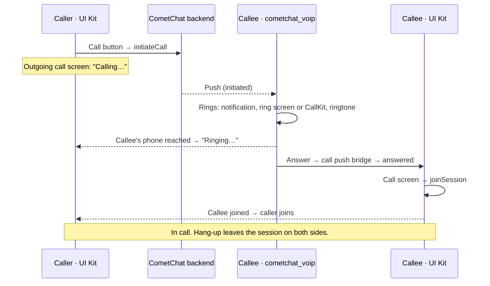

<Accordion title="AI Integration Quick Reference">

| Field | Value |
| --- | --- |
| Package | `cometchat_chat_uikit` (brings `cometchat_calls_sdk`); `cometchat_voip` in your app for ringing |
| Import | `import 'package:cometchat_chat_uikit/cometchat_calls_uikit.dart';` |
| Required setup | `enableCalls = true` and `callPushBridge` in `UIKitSettings`, `CallNavigationContext.navigatorKey` on `MaterialApp`, `cometchat_voip` initialized, every push handed to `CometChatVoip.handlePushNotification` |
| Incoming calls | Rung by `cometchat_voip` (notification and ring screen on Android, CallKit on iOS), in every app state. No call listener, no incoming call component |
| Key classes | `CometChatCallButtons` · `CometChatOutgoingCall` · `CometChatOngoingCall` · `CometChatCallLogs` · `CometChatCallPushBridge` |
| Deprecated / superseded | `CometChatIncomingCall` (web only); Chat SDK `CometChat.addCallListener` / `initiateCall` / `acceptCall` / `rejectCall` / `endCall` (superseded) |
| Related | [Calling Integration](/ui-kit/flutter/calling-integration) · [Push Ringing](/calls/flutter/voip-calling) · [Migrating from Legacy Ringing](/calls/flutter/migrating-from-legacy-ringing) |

</Accordion>

CometChat's Calls feature lets you add one-on-one and group audio and video calling to your application. This page is an overview of how calling works in the Flutter UI Kit and which component handles each part.

## How a call works

- **Placing a call** is done by the UI Kit through the Calls SDK. The Chat SDK is not involved.
- **Ringing the callee** is done by `cometchat_voip` from the call push, with the app in the foreground, in the background or killed. It draws the ring screen (CallKit on iOS) and asks for the microphone and camera on Answer.
- **Joining** is done by the UI Kit: `cometchat_voip` hands the answered call to it through your app's call push bridge, and the UI Kit opens its call screen.
- **Decline, timeout, busy and missed calls** are handled by `cometchat_voip`. The caller's outgoing call screen closes.
- **The call itself** runs in the Calls SDK session on the UI Kit's call screen; hanging up leaves the session.

## Integration

All steps are on the [Calling Integration](/ui-kit/flutter/calling-integration) page:

1. Add `cometchat_voip` and Firebase, and initialize the Calls SDK and `cometchat_voip` at app start.
2. Add the call push bridge (a short class over `cometchat_voip`) and set `enableCalls` and `callPushBridge` in `UIKitSettings`.
3. Set `CallNavigationContext.navigatorKey` on your `MaterialApp`.
4. Hand every push to `cometchat_voip` on Android, register the push token, check ring readiness after login, and log out through `CometChatUIKit.logout`.

<Note>
There is no call listener to add. Apps that registered `CometChat.addCallListener` to show the incoming call screen should remove it; the Chat SDK's calling APIs are superseded. See [Migrating from Legacy Ringing](/calls/flutter/migrating-from-legacy-ringing). On web, which has no push ringing, the UI Kit keeps ringing calls with the Chat SDK.
</Note>

## Call Components

### Call Buttons

`CometChatCallButtons` places audio and video calls. It renders in the [Message Header](/ui-kit/flutter/message-header) when calls are enabled.

[Learn more about Call Buttons →](/ui-kit/flutter/call-buttons)

### Outgoing Call

`CometChatOutgoingCall` shows "Calling…", then "Ringing…" once the callee's phone is reached, closes if the call is declined, busy or unanswered, and opens the call screen once the callee joins.

<Frame>
  
</Frame>

[Learn more about Outgoing Call →](/ui-kit/flutter/outgoing-call)

### Incoming Call

On Android and iOS, incoming calls are rung and drawn by `cometchat_voip`, so there is no UI Kit component to place. The deprecated `CometChatIncomingCall` is shown on web only.

[Incoming Call (deprecated) →](/ui-kit/flutter/incoming-call)

### Call Logs

`CometChatCallLogs` displays the history of calls, including missed, received and dialed calls. Users can open call details and call back from the log.

<Frame>
  
</Frame>

[Learn more about Call Logs →](/ui-kit/flutter/call-logs)

### Call Log Details

For participants, join and leave history and recordings of a call, see the [Call Log Details](/ui-kit/flutter/guide-call-log-details) guide.
