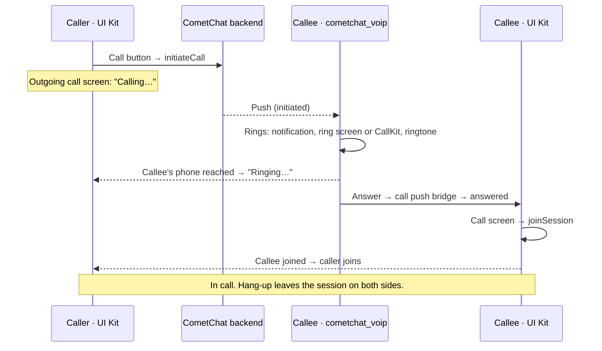

## Overview

With calling enabled, the UI Kit places calls from the message header and call logs, shows the outgoing call screen, and hosts the in-call screen. Incoming calls ring through `cometchat_voip`, CometChat's push ringing package: it shows the call notification and the ring screen (CallKit on iOS), plays the ringtone, and hands the answered call to the UI Kit, which opens its call screen and joins. This works with the app in the foreground, in the background or killed.

<Info>
Make sure you've completed the [Getting Started](/ui-kit/flutter/getting-started) guide before proceeding.
</Info>

{/* TODO(RC): every API on this page is from the ringing-v2-uikit branch (cometchat_calls_sdk 5.1.0-team + cometchat_voip release/2.0). The branch's pubspec still says version 6.2.0, which is the release already on pub.dev; it needs its own bump before this page can pin a real version. Re-check against the released packages before publishing. The ring screen theme (CometChatIncomingCallTheme in the UI Kit; CometChatVoipIncomingCallTheme and setIncomingCallTheme in cometchat_voip) is from ringing-v2-uikit and feat/voip-incoming-call-theme and needs the same check. */}



What you write: the UI Kit settings with calls enabled, the `cometchat_voip` setup, a small call push bridge, the push hand-off, and the platform permissions. There is no call listener to register and no incoming call screen to show.

## Step 1: Dependencies

The UI Kit brings the Calls SDK. Calling through `cometchat_voip` needs a UI Kit newer than 6.2.0 — 6.2.0 doesn't carry the call push bridge. Add `cometchat_voip` for ringing, and Firebase for call pushes on Android:

```yaml pubspec.yaml
dependencies:
  cometchat_chat_uikit: ^6.3.0
  cometchat_voip: ^2.0.0
  firebase_core: ^3.0.0
  firebase_messaging: ^15.0.0
```

{/* TODO(RC): confirm the UI Kit release that ships ringing through cometchat_voip, and the published cometchat_voip version. 6.2.0 is already on pub.dev WITHOUT the bridge API, so this pin must name the first release that has it (6.3.0 here is a placeholder). Bump ui-kit/flutter/getting-started.mdx to match. */}

<Tabs>
<Tab title="Android">
`minSdk 26` (already required by the UI Kit), and your Firebase configuration (`google-services.json`). `cometchat_voip` adds the permissions, services and ring screen it needs to the manifest.
</Tab>
<Tab title="iOS">
1. `platform :ios, '15.1'` in the `Podfile` (already required by the UI Kit).
2. In Xcode, add the **Push Notifications** capability, and under **Background Modes** check **Voice over IP** and **Remote notifications**.
3. Add `NSMicrophoneUsageDescription` and `NSCameraUsageDescription` to `Info.plist`.

No `AppDelegate` code is needed: `cometchat_voip` owns PushKit and CallKit. Don't create a `PKPushRegistry` of your own; a second registry takes the VoIP pushes and those calls never ring.
</Tab>
</Tabs>

Push notifications must be enabled in the CometChat dashboard, with the push providers set up. See [Getting Started](/notifications/push-getting-started).

## Step 2: Initialize the Calls SDK and cometchat_voip

`cometchat_voip` needs the Calls SDK initialized first. Do both at app start, before `CometChatUIKit.init`, and again in the Android background message handler (Step 5), where your app's start-up code hasn't run:

```dart
final callAppSettings = (CallAppSettingBuilder()
      ..appId = "APP_ID"
      ..region = "REGION")
    .build();

Future<void> initPushRinger() async {
  final done = Completer<void>();
  CometChatCalls.init(
    callAppSettings,
    onSuccess: (_) => done.complete(),
    onError: (CometChatCallsException e) => done.complete(),
  );
  await done.future;

  await CometChatVoip.init(
    CometChatVoipConfig.fromCallAppSettings(
      callAppSettings,
      providerId: "PROVIDER_ID", // the FCM provider on Android, the APNs provider on iOS
    ),
  );
}
```

Every `cometchat_voip` option (ring timeout, missed call notifications, your own ring screen) is on the Calls SDK's [Push Ringing](/calls/flutter/voip-calling#step-2-initialize) page. To colour the ring screen with your UI Kit theme, see [Styling the ring screen](#styling-the-ring-screen).

## Step 3: Connect cometchat_voip to the UI Kit

The UI Kit doesn't depend on `cometchat_voip`. It talks to the push ringer through `CometChatCallPushBridge`, which your app implements over `cometchat_voip`. Through the bridge the UI Kit:

- joins every call answered on the ring screen or CallKit, on its own call screen (`answered`), including a call that started the app;
- forgets a call that stopped ringing, and closes the call screen of a call ended from CallKit (`ended`);
- stops the ring of a call it declines itself, for example as busy (`dismissRinging`);
- on iOS, reports the calls it places, joins and ends to CallKit.

Copy this bridge into your app:

```dart
import 'package:cometchat_chat_uikit/cometchat_calls_uikit.dart'
    show CometChatCallPushBridge, CometChatPushCall, CometChatPushCallEnded;
import 'package:cometchat_voip/cometchat_voip.dart';

class VoipCallPushBridge extends CometChatCallPushBridge {
  const VoipCallPushBridge();

  static CometChatPushCall _call(CometChatVoipCall call) => CometChatPushCall(
        sessionId: call.sessionId,
        callType: call.callType,
        receiverType: call.receiverType,
        callerUid: call.callerUid,
        callerName: call.callerName,
        callerAvatarUrl: call.callerAvatarUrl,
      );

  @override
  Stream<CometChatPushCall> get answered =>
      CometChatVoip.onCallAnswered.map(_call);

  @override
  Stream<CometChatPushCallEnded> get ended => CometChatVoip.onCallEnded.map(
        (ended) => CometChatPushCallEnded(
          call: _call(ended.call),
          reason: ended.reason.wireName,
        ),
      );

  @override
  Future<void> answer(String sessionId) => CometChatVoip.answer(sessionId);

  @override
  Future<void> decline(String sessionId) => CometChatVoip.decline(sessionId);

  @override
  Future<void> dismissRinging(String sessionId, {required bool answered}) =>
      CometChatVoip.dismissRinging(sessionId, answered: answered);

  @override
  Future<void> reportOutgoingCall({
    required String sessionId,
    required String calleeName,
    bool hasVideo = false,
  }) =>
      CometChatVoip.reportOutgoingCall(
        sessionId: sessionId,
        calleeName: calleeName,
        hasVideo: hasVideo,
      );

  @override
  Future<void> reportCallConnected(String sessionId) =>
      CometChatVoip.reportCallConnected(sessionId);

  @override
  Future<void> reportCallEnded(String sessionId) =>
      CometChatVoip.reportCallEnded(sessionId);
}
```

<Note>
Extend `CometChatCallPushBridge` rather than implementing it: members added in a later release come with a default, so your bridge keeps compiling.
</Note>

## Step 4: Enable calls in the UI Kit

Set `enableCalls`, give the UI Kit the bridge, and give `MaterialApp` the UI Kit's navigator key so the UI Kit can open its call screens from anywhere, including for a call answered while the app was killed.

```dart
UIKitSettings uiKitSettings = (UIKitSettingsBuilder()
      ..subscriptionType = CometChatSubscriptionType.allUsers
      ..autoEstablishSocketConnection = true
      ..appId = "APP_ID"
      ..region = "REGION"
      ..authKey = "AUTH_KEY"
      ..enableCalls = true
      ..callingConfiguration = CallingConfiguration()
      ..callPushBridge = const VoipCallPushBridge())
    .build();

CometChatUIKit.init(
  uiKitSettings: uiKitSettings,
  onSuccess: (successMessage) {},
  onError: (e) {},
);
```

```dart
MaterialApp(
  navigatorKey: CallNavigationContext.navigatorKey,
  home: YourHomeScreen(),
)
```

With `enableCalls`, `CometChatUIKit.init` initializes the Calls SDK and `CometChatUIKit.login` logs the user into it. Initialize and log in at app start from stored credentials, not only after a screen opens: an answer can start the app, and the UI Kit joins it as soon as the user is logged in.

## Step 5: Hand call pushes to cometchat_voip

On Android, pass every push to `cometchat_voip`, from both the foreground and the background handler. It returns `true` for a call push; anything else is yours to handle (chat notifications, for example).

```dart
// Foreground: FirebaseMessaging.onMessage.listen(onForegroundMessage)
Future<void> onForegroundMessage(RemoteMessage message) async {
  bool isCallPush = await CometChatVoip.handlePushNotification(
    message.data,
    sentTime: message.sentTime,
  );
  if (!isCallPush) {
    // A chat notification: handle it as you do today.
  }
}

// Background and killed: FirebaseMessaging.onBackgroundMessage(onBackgroundMessage)
@pragma('vm:entry-point')
Future<void> onBackgroundMessage(RemoteMessage message) async {
  await Firebase.initializeApp();
  if (!CometChatVoip.isInitialized) {
    await initPushRinger(); // Step 2
  }
  await CometChatVoip.handlePushNotification(
    message.data,
    sentTime: message.sentTime,
  );
}
```

Don't skip call pushes when the app is in the foreground: the push is the only incoming call signal, in every app state. Call pushes must be sent at high priority. On iOS there's nothing to hand over: VoIP pushes go straight to `cometchat_voip`.

## Step 6: Register the push token

```dart
// Android: after login
String? fcmToken = await FirebaseMessaging.instance.getToken();
if (fcmToken != null) {
  await CometChatVoip.registerPushToken(token: fcmToken);
}
FirebaseMessaging.instance.onTokenRefresh.listen(CometChatVoip.handleTokenRefresh);
```

On iOS, `cometchat_voip` registers the PushKit token itself when the user logs in.

## Step 7: Permissions and ring readiness

- **Microphone and camera:** `cometchat_voip` asks when the user answers, and the UI Kit's call screen asks before it joins. If the microphone is refused, the call doesn't join and the UI Kit shows a notice that offers the app settings (or calls your `onError`).
- **Ring readiness:** some device settings silence a call with no error anywhere (notifications off, a muted call channel, full-screen alerts not allowed, Do Not Disturb). Check once after login and tell the user:

```dart
CometChatRingReadiness readiness = await CometChatVoip.checkRingReadiness();
if (readiness != CometChatRingReadiness.ready) {
  // Explain why, then open the right settings page:
  await CometChatVoip.openSettings(readiness);
}
```

## Step 8: Log out through the UI Kit

```dart
await CometChatVoip.unregisterPushToken();
CometChatUIKit.logout(
  onSuccess: (s) {
    // Go to your login screen
  },
  onError: (e) {},
);
```

Unregister the push token first, while the user's session still works. `CometChatUIKit.logout` then declines a call still ringing, cancels an outgoing call still ringing, leaves a call in progress, and logs out of the Chat SDK and the Calls SDK. `CometChat.logout` alone does none of the calling clean-up.

## Styling the ring screen

On Android, the ring screen belongs to `cometchat_voip`, which draws it even when your app isn't running, so it can't read your `ThemeData` when a call arrives. Pass it your UI Kit colours once instead, light and dark. The ring screen and the call notifications then follow your theme. Without this, the ring screen keeps `cometchat_voip`'s own dark colours.

The UI Kit reads your theme into a `CometChatIncomingCallTheme`:

```dart
// The same ThemeData you give MaterialApp's theme and darkTheme
final uikitTheme = CometChatIncomingCallTheme.from(
  light: lightTheme,
  dark: darkTheme,
);

// Or, from a widget under your MaterialApp:
final uikitTheme = CometChatIncomingCallTheme.of(context);
```

Each set is read from the `CometChatColorPalette` in that `ThemeData`, and the UI Kit's default colours fill anything the palette leaves out. The mode comes from `CometChatThemeMode.mode`, so a UI Kit forced to light or dark rings in that mode whatever the phone's setting.

The UI Kit doesn't depend on `cometchat_voip`, so a small extension in your app copies the colours across. The field names match one to one:

```dart lib/incoming_call_theme.dart
import 'package:cometchat_chat_uikit/cometchat_calls_uikit.dart';
import 'package:cometchat_voip/cometchat_voip.dart';
import 'package:flutter/material.dart';

extension IncomingCallThemeToVoip on CometChatIncomingCallTheme {
  CometChatVoipIncomingCallTheme toVoip() => CometChatVoipIncomingCallTheme(
        mode: switch (mode) {
          ThemeMode.light => CometChatVoipIncomingCallThemeMode.light,
          ThemeMode.dark => CometChatVoipIncomingCallThemeMode.dark,
          ThemeMode.system => CometChatVoipIncomingCallThemeMode.system,
        },
        light: light._toVoip(),
        dark: dark._toVoip(),
      );
}

extension on CometChatIncomingCallColors {
  CometChatVoipIncomingCallColors _toVoip() => CometChatVoipIncomingCallColors(
        background: background,
        callerName: callerName,
        subtitle: subtitle,
        avatarBackground: avatarBackground,
        avatarText: avatarText,
        acceptButton: acceptButton,
        acceptIcon: acceptIcon,
        acceptLabel: acceptLabel,
        declineButton: declineButton,
        declineIcon: declineIcon,
        declineLabel: declineLabel,
      );
}
```

Then pass it once at app start, after [Step 2](#step-2-initialize-the-calls-sdk-and-cometchat_voip):

```dart
await CometChatVoip.setIncomingCallTheme(
  CometChatIncomingCallTheme.from(light: lightTheme, dark: darkTheme).toVoip(),
);
```

The theme is saved, so it also applies to a call that starts your app from killed, and your background message handler needs no change. If your app changes its UI Kit colours or `CometChatThemeMode.mode` while running, pass the new theme the same way.

Each field comes from one `CometChatColorPalette` colour:

| Ring screen field | `CometChatColorPalette` colour |
|---|---|
| `background` | `background1` |
| `callerName` | `textPrimary` |
| `subtitle`, `acceptLabel`, `declineLabel` | `textSecondary` |
| `avatarBackground` | `primary` |
| `avatarText`, `acceptIcon`, `declineIcon` | `white` |
| `acceptButton` | `success` |
| `declineButton` | `error` |

To change a single colour, change it in your `CometChatColorPalette`, or replace that field in the extension above. The full list of colours is under [Theming the ring screen](/calls/flutter/voip-calling#theming-the-ring-screen). To show a different screen altogether, use [your own ring screen](/calls/flutter/voip-calling#your-own-ring-screen). On iOS, CallKit draws the call, and nothing here applies.

## What the UI Kit does from here

Once calling is enabled, the voice and video call buttons appear in the [Message Header](/ui-kit/flutter/message-header).

<Frame>
  
</Frame>

| Moment | What happens | Component |
|--------|--------------|-----------|
| Tap a call button | The call is placed, then the outgoing call screen opens | [Call Buttons](/ui-kit/flutter/call-buttons) |
| Waiting | "Calling…", then "Ringing…" when the callee's phone is reached; End cancels the call; 45 seconds with no answer ends it as unanswered | [Outgoing Call](/ui-kit/flutter/outgoing-call) |
| Callee declines, is busy or doesn't answer | The outgoing call screen closes | Outgoing Call |
| Incoming call | `cometchat_voip` rings and draws the ring screen (CallKit on iOS), in your UI Kit colours once you [pass them](#styling-the-ring-screen) | `cometchat_voip` (no UI Kit component) |
| Answer | The UI Kit's call screen opens and joins | Call screen |
| A call during a 1:1 call | Rings over it; answering ends the current call and joins the new one | Call screen |
| Hang-up | The session is left; the other side's screen closes | Call screen |
| Call history | Call logs list from the Calls SDK; the call icon calls back | [Call Logs](/ui-kit/flutter/call-logs) |
| Group call | The group call button sends a meeting message and joins the conference; members join from the message | Call Buttons |

To react to calls in your own code, listen to the UI Kit's [call events](/ui-kit/flutter/events#call-events), or to the Calls SDK's `CometChatCalls.addIncomingCallListener`. Don't use the Chat SDK's `CallListener`: it is superseded and fires nothing in this flow on Android and iOS.

<Note>
**Web** has no push ringing: there, the UI Kit keeps ringing calls with the Chat SDK and its own [Incoming Call](/ui-kit/flutter/incoming-call) screen. `callPushBridge` is not used on web.
</Note>

## Upgrading from an app that used `CometChat.addCallListener`

Remove the `CallListener` you registered to show the UI Kit's incoming call screen, and any push, PushKit, CallKit or `flutter_callkit_incoming` code you wrote to ring calls in the background, then follow the steps above. The UI Kit no longer re-exports `CallListener` and `CallListener2`; import them from `cometchat_sdk` if you still use them on web. The method-by-method mapping is on [Migrating from Legacy Ringing](/calls/flutter/migrating-from-legacy-ringing).
