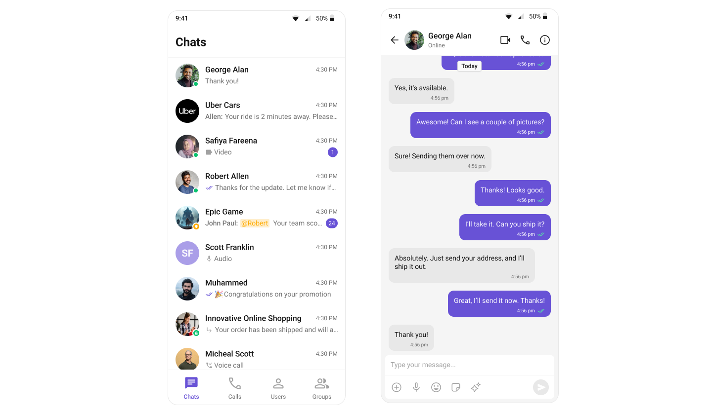

import BuildWithAIUpgrade from '/snippets/ai/build-with-ai-upgrade.mdx';

<Note>
🚀 **V6 Available** — The Flutter UI Kit V6 is now available with BLoC state management, clean architecture, and improved performance. [Check out the V6 Overview →](/ui-kit/flutter/overview)
</Note>

<Accordion title="AI Agent Component Spec">

| Field | Value |
| --- | --- |
| Package | `cometchat_chat_uikit` v5.2.x |
| Calling | Optional — `cometchat_calls_uikit` |
| Platforms | iOS 13.0+, Android API 21+ |
| Flutter | 3.0+ recommended |
| Localization | Built-in support |
| Source | [GitHub](https://github.com/cometchat/cometchat-uikit-flutter/tree/v5/chat_uikit) |
| AI Skills | `npx @cometchat/skills add` (targets v6; ask it to upgrade from v5) — [Agent Skills](/agent-skills) |

</Accordion>

The CometChat Flutter UI Kit provides prebuilt, customizable widgets for adding chat, voice, and video calling to any Flutter app. Each widget handles its own data fetching, real-time listeners, and state — you just drop them into your layout.

<Frame>
  
</Frame>

---

## Build with AI

<BuildWithAIUpgrade kit="Flutter UI Kit" version="v5" current="v6" currentHref="/ui-kit/flutter/overview" prompt="upgrade my CometChat Flutter UI Kit from v5 to v6" />

---

## Try It

<CardGroup> 
  <Card title="Sample App" icon="github" href="https://github.com/cometchat/cometchat-uikit-flutter/tree/v5/sample_app">
    Clone and run the Flutter sample project
  </Card>
</CardGroup>

---

## Get Started

<Frame>
  <iframe width="100%" height="400" src="https://www.youtube.com/embed/I0yVOMlPMqc" title="YouTube video" frameBorder="0" allow="accelerometer; autoplay; clipboard-write; encrypted-media; gyroscope; picture-in-picture; web-share"></iframe>
</Frame>

<Card title="Getting Started" icon="rocket" href="/ui-kit/flutter/v5/getting-started">
  Install, initialize, and build your first chat screen
</Card>

---

## Explore

<CardGroup cols={2}>
  <Card title="Components" icon="grid-2" href="/ui-kit/flutter/v5/components-overview">
    Browse all prebuilt UI widgets
  </Card>
  <Card title="Features" icon="comments" href="/ui-kit/flutter/v5/core-features">
    Chat, calling, AI, and extensions
  </Card>
  <Card title="Theming" icon="paintbrush" href="/ui-kit/flutter/v5/theme-introduction">
    Colors, fonts, dark mode, and custom styling
  </Card>
  <Card title="Key Concepts" icon="book" href="/fundamentals/key-concepts">
    Understand CometChat's core concepts
  </Card>
</CardGroup>

---

## Resources

<CardGroup cols={3}>
  <Card title="Sample App" icon="github" href="https://github.com/cometchat/cometchat-uikit-flutter/tree/v5/sample_app">
    Working reference app
  </Card>
  <Card title="Source Code" icon="code" href="https://github.com/cometchat/cometchat-uikit-flutter/tree/v5/chat_uikit">
    Full UI Kit source on GitHub
  </Card>
  <Card title="Figma" icon="figma" href="https://www.figma.com/community/file/1444324233177163609/cometchat-ui-kit-for-flutter">
    Design resources and prototyping
  </Card>
  <Card title="Troubleshooting" icon="wrench" href="/ui-kit/flutter/v5/troubleshooting">
    Common issues and fixes
  </Card>
  <Card title="Support" icon="headset" href="https://help.cometchat.com/hc/en-us/requests/new">
    Open a support ticket
  </Card>
  <Card title="Migration Guide" icon="arrow-up" href="/ui-kit/flutter/v5/upgrading-from-v4">
    Upgrading from v4
  </Card>
</CardGroup>
