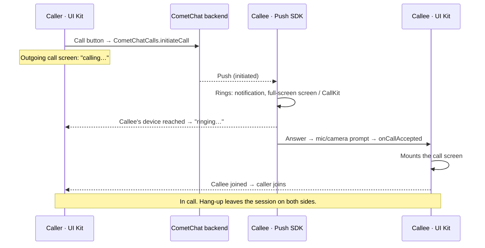

<Accordion title="AI Integration Quick Reference">

| Field | Value |
| --- | --- |
| Packages | `@cometchat/calls-sdk-react-native` (**not** `@cometchat/calls-sdk-javascript`, that is the web package) · `@cometchat/push-notifications-react-native` · `@cometchat/push-notifications-voip-react-native` |
| Extra deps | `@react-native-community/netinfo` · `react-native-background-timer` · `react-native-callstats` · `react-native-webrtc` · `@react-native-firebase/messaging` |
| Enabling | **Installing the packages is the switch** — the UI Kit detects the Calls SDK at startup. There is no `setEnableCalling()` in React Native. Opt out with `disableCalling: true` |
| Incoming calls | Rung by the Push SDK in every app state. No `CallListener`, no incoming-call component to render |
| Version floors | Android `minSdkVersion 26` · iOS 13 — below these calls do not ring |
| Permissions | iOS `NSCameraUsageDescription` + `NSMicrophoneUsageDescription` + the `voip` background mode; Android `CAMERA`, `RECORD_AUDIO`, `MODIFY_AUDIO_SETTINGS`, `POST_NOTIFICATIONS` |
| After installing | `pod install` (bare) or a fresh development build (Expo). A JS reload will not pick up the native modules |
| Testing | Simulators cannot capture camera or microphone, and CallKit does not present calls there; verify ringing on real devices |
| Related | [Ringing](/calls/react-native/ringing) · [Push Ringing](/calls/react-native/voip-calling) · [Call Buttons](/ui-kit/react-native/call-buttons) |

</Accordion>

## Overview

With calling enabled, the UI Kit places calls from the message header and call logs, shows the outgoing call screen, and hosts the in-call screen. Incoming calls ring through the CometChat Push Notifications SDK: it shows the call notification and the full-screen incoming-call screen on Android and a CallKit call on iOS, plays the ringtone, and hands the answered call to your app, with the app in the foreground, in the background or not running at all.

<Info>
Make sure you've completed the [Getting Started](/ui-kit/react-native/react-native-cli-integration) guide before proceeding.
</Info>



What you write: the packages installed, the Push SDK configuration, one event subscription that opens your call screen, and the manifest permissions. There is no call listener to register and no incoming-call UI to show.

## Step 1: Dependencies

```bash
npm install @cometchat/chat-uikit-react-native \
            @cometchat/calls-sdk-react-native \
            @cometchat/push-notifications-react-native \
            @cometchat/push-notifications-voip-react-native \
            @react-native-firebase/app @react-native-firebase/messaging
cd ios && pod install
```

Installing the Calls SDK is what enables calling; the UI Kit detects it at startup. Put `google-services.json` in `android/app/` and `GoogleService-Info.plist` in your iOS target.

`minSdkVersion` must be 26 or higher for ringing, and the iOS deployment target 13 or higher.

<Note>
The UI Kit requires `@cometchat/calls-sdk-react-native` 5.1 or newer and both Push Notifications packages at 2.0 or newer. Ringing behaviour described here does not exist below those versions.
</Note>

## Step 2: Initialise, in this order

```ts
import { CometChatUIKit } from '@cometchat/chat-uikit-react-native';
import { CometChatPushNotifications } from '@cometchat/push-notifications-react-native';
import { CometChatVoipNotifications } from '@cometchat/push-notifications-voip-react-native';

// 1. Push first — a call push may be what started this process.
await CometChatPushNotifications.init({
  appId: APP_ID,
  region: REGION,
  fcmProviderId: FCM_PROVIDER_ID,
  apnsProviderId: APNS_PROVIDER_ID,
  notificationSmallIcon: 'ic_notification',
  callKitName: 'Acme',
});
await CometChatVoipNotifications.init();          // no config — see the warning

// 2. Then the UI Kit, which initialises the Chat and Calls SDKs.
await CometChatUIKit.init({ appId: APP_ID, region: REGION, authKey: AUTH_KEY });
```

<Warning>
**Do not pass a config to `CometChatVoipNotifications.init()` in a chat app.** It re-runs the core initialisation and drops `notificationSmallIcon`, `androidChannelId` and every other chat-side option. Only a calls-only app, which never calls `CometChatPushNotifications.init`, passes its config there.
</Warning>

<Warning>
**`CometChatVoipNotifications.init()` must be the first thing your app awaits.** A cold launch caused by a call push has a ring window measured from the caller's side; anything awaited before it — stored credentials, a remote config fetch, the login — spends that window and the call is lost.
</Warning>

Run this at your app's entry point from stored credentials, not only after a screen opens. A push can start the app process to ring a call, and the answer must find a ready SDK.

Also register the background task, at module scope:

```js index.js
import { registerBackgroundCallTask } from '@cometchat/push-notifications-voip-react-native';
registerBackgroundCallTask();
```

### Staging or dedicated deployments

Pass the same host to the UI Kit and the Push SDK. Otherwise the push token registers on the default production host, where your app id does not exist, and no call push ever arrives.

```ts
await CometChatPushNotifications.init({ appId: APP_ID, region: REGION, clientHost: CLIENT_HOST });
await CometChatUIKit.init({ appId: APP_ID, region: REGION, authKey: AUTH_KEY, overrideClientHost: CLIENT_HOST });
```

<Warning>
The Chat SDK wants a bare host and the Calls SDK a full URL; giving one the other's shape hangs login forever rather than failing with an error.
</Warning>

## Step 3: Open your call screen when the user answers

This is the only calling code an incoming call needs:

```tsx
function App() {
  const [activeCall, setActiveCall] = useState(null);

  useEffect(() => {
    const off = CometChatVoipNotifications.onCallAccepted(call => setActiveCall(call));
    const offEnded = CometChatVoipNotifications.onCallEnded(() => setActiveCall(null));
    return () => { off(); offEnded(); };
  }, []);

  if (activeCall) return <CallScreen sessionId={activeCall.sessionId} />;
  return <Chats />;
}
```

A call answered before your JavaScript existed is buffered natively and replayed to the first subscriber, so subscribing late is safe — not subscribing at all means the user answers and nothing happens.

Every option of the push configuration (ring timeout, missed-call notifications, your own ring screen, MANUAL mode) is on the Calls SDK's [Push Ringing](/calls/react-native/voip-calling) page.

## Step 4: Permissions

```xml android/app/src/main/AndroidManifest.xml
<uses-permission android:name="android.permission.INTERNET" />
<uses-permission android:name="android.permission.CAMERA" />
<uses-permission android:name="android.permission.RECORD_AUDIO" />
<uses-permission android:name="android.permission.MODIFY_AUDIO_SETTINGS" />
<uses-permission android:name="android.permission.ACCESS_NETWORK_STATE" />
<uses-permission android:name="android.permission.POST_NOTIFICATIONS" />
```

```xml ios/{appname}/Info.plist
<key>NSCameraUsageDescription</key>
<string>Access camera</string>
<key>NSMicrophoneUsageDescription</key>
<string>Access microphone</string>
<key>UIBackgroundModes</key>
<array><string>voip</string><string>audio</string></array>
```

The remaining permissions and components (full-screen intent, the ringing foreground service, the ring screen, PushKit and CallKit) come from the Push SDK's own manifests.

<Warning>
**A missing `NSMicrophoneUsageDescription` terminates the app mid-ring on iOS**, which looks exactly like the ring expiring early.
</Warning>

At runtime:

- **Notifications**: after sign-in, call `CometChatPushNotifications.ensureRingReady()` and show the user anything other than `ready`. Notifications off, a muted call channel, a revoked full-screen intent and Do Not Disturb all silence calls with no error.
- **Microphone and camera**: the Push SDK asks when the user answers; a denied microphone joins muted. Ask at sign-in as well with `CometChatPNHelper.requestCallPermissions()` if you do not want the first call to be where the user meets the prompt.

```ts
const readiness = await CometChatPushNotifications.ensureRingReady();
if (readiness !== 'ready') {
  Alert.alert('Incoming calls may not ring', String(readiness));
  await CometChatPushNotifications.openRingSettings();
}
```

## Step 5: Log out through the UI Kit

```ts
await CometChatPushNotifications.unregister();   // needs the credential; must come first
CometChatVoipNotifications.clearIdentity();
await CometChatUIKit.logout();
```

`CometChatUIKit.logout` logs out of the Chat SDK and the Calls SDK. `unregister()` must run **before** it: deleting the token from the backend needs the logged-in credential, and skipping it leaves the device receiving the departed user's call pushes.

## What the UI Kit does from here

Once calling is active, the voice and video call buttons render in the [MessageHeader](/ui-kit/react-native/message-header).

<Frame>
  
</Frame>

| Moment | What happens | Component |
|--------|--------------|-----------|
| Tap a call button | `CometChatCalls.initiateCall`, then the outgoing screen opens | [Call Buttons](/ui-kit/react-native/call-buttons) |
| Waiting | "Calling…", then "Ringing…" when the callee's device is reached; End cancels the call; 45 s with no answer ends it as unanswered | [Outgoing Call](/ui-kit/react-native/outgoing-call) |
| Callee declines / is busy / does not answer | The outgoing screen closes with the reason | Outgoing Call |
| Incoming call | The Push SDK rings and draws the incoming-call screen | Push SDK (no UI Kit component) |
| Answer | `onCallAccepted` fires and your call screen mounts | [Call Features](/ui-kit/react-native/call-features) |
| Hang-up | The session is left; the other side's screen closes | Call Features |
| Call history | Call logs list from the Calls SDK; the call icon calls back | [Call Logs](/ui-kit/react-native/call-logs) |

<Note>
**"Ringing…" only appears when the call was delivered by push.** A call delivered over the websocket to an app already in the foreground makes no pre-join on the callee's side, so the caller's screen stays on "Calling…".
</Note>

To react to calls in your own code (a badge, analytics, refreshing a screen), subscribe to `CometChatVoipNotifications.onCallRinging` and `onCallEnded`. Do not use the Chat SDK's deprecated `CallListener`.

## Styling the incoming-call screen

The incoming-call screen is drawn natively, before any JavaScript exists, so the UI Kit theme cannot reach it.

<Warning>
**The Android ring screen's colours are not currently overridable** — they are compiled into the screen. Its strings and the call icon can be overridden by declaring the same resource names in your app; on iOS the screen is CallKit's and only `callKitName`, `callKitIconName` and `callKitRingtone` are yours.
</Warning>

To make the in-app ring match your theme, set `ringInForeground: false` and render your own screen from `CometChatVoipNotifications.onCallRinging`. See [Theming the ring](/calls/react-native/voip-calling#theming-the-ring) and [Your own incoming-call screen](/calls/react-native/voip-calling#your-own-incoming-call-screen).

## Upgrading from an app that used `CometChat.addCallListener`

Remove the `CallListener`, the `CometChatIncomingCall` component you rendered from it, any ringtone you played, the busy check, and the `react-native-callkeep` / `react-native-voip-push-notification` wiring, then follow the steps above. The method-by-method mapping is on [Migrating from Legacy Ringing](/calls/react-native/migrating-from-legacy-ringing).
