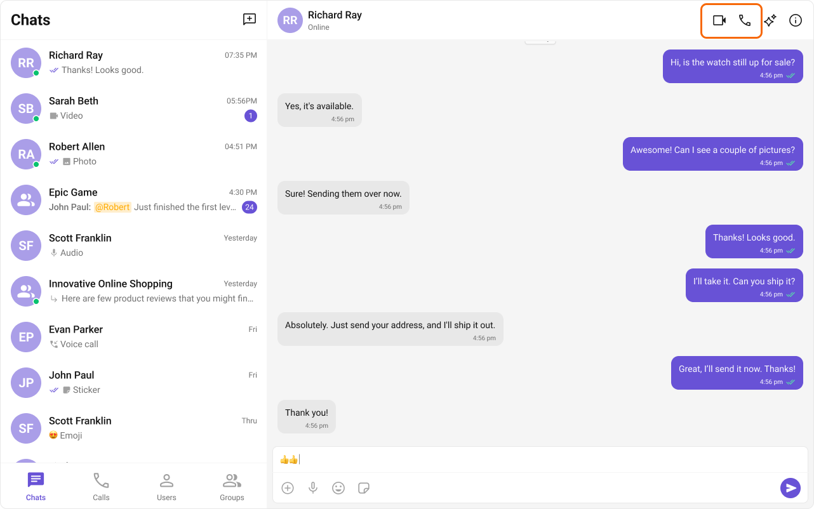
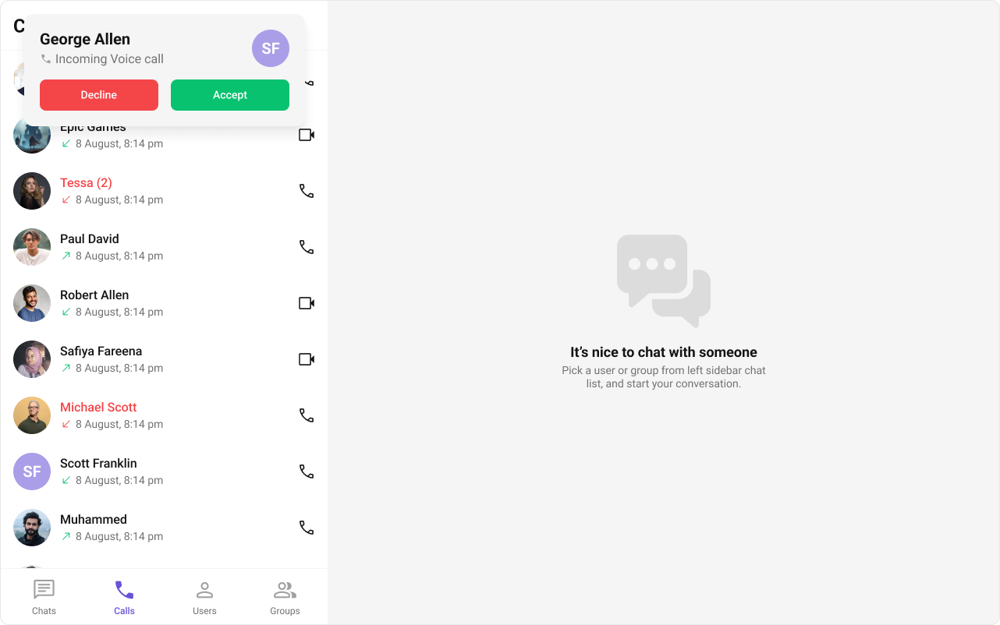
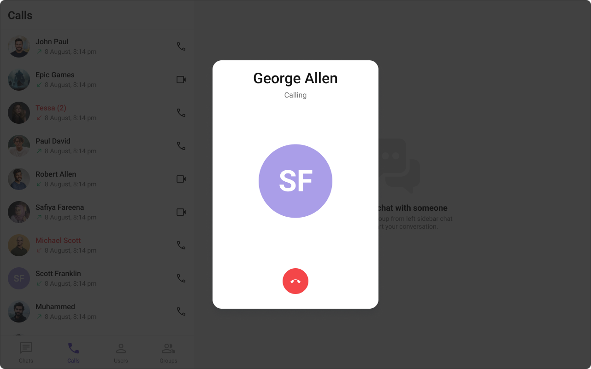
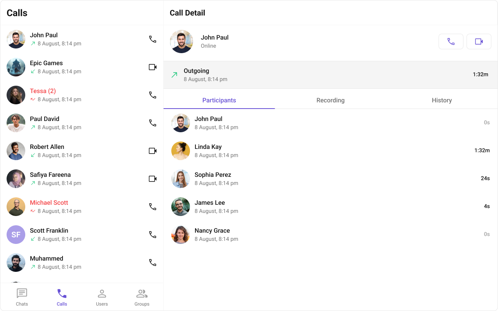

<Accordion title="AI Integration Quick Reference">

| Field | Value |
| --- | --- |
| Packages | `@cometchat/chat-uikit-react` + `@cometchat/calls-sdk-javascript` 5.1.1 or later (`npm install @cometchat/calls-sdk-javascript@^5.1.1`) |
| Required setup | Call `.setCallingEnabled(true)` on `UIKitSettingsBuilder` during init — Calls SDK must also be installed |
| Call features | Incoming Call, Outgoing Call, Call Logs, Call Buttons (in Message Header) |
| Key components | `CometChatMessageHeader` → [Message Header](/ui-kit/react/components/message-header) (includes call buttons), `CometChatIncomingCall` → [Incoming Call](/ui-kit/react/components/incoming-call), `CometChatOutgoingCall` → [Outgoing Call](/ui-kit/react/components/outgoing-call), `CometChatCallLogs` → [Call Logs](/ui-kit/react/components/call-logs) |
| Enabling | Set `.setCallingEnabled(true)` on `UIKitSettingsBuilder` to activate call UI components |
| How 1:1 calls ring | Through the Calls SDK 5.1 ringing flow; group calls send a meeting message. See [How calls ring](#how-calls-ring) |
| CSS class prefix | `.cometchat-` |

</Accordion>

## Overview

CometChat Calls integrates 1:1 and group audio/video calling into the React UI Kit. Install the Calls SDK and enable calling via `.setCallingEnabled(true)` on `UIKitSettingsBuilder` to activate call components.

<Note>
Ensure you have called `CometChatUIKit.init()` with `.setCallingEnabled(true)` and `CometChatUIKit.login()` before rendering. See [React.js Integration](/ui-kit/react/integration-react).
</Note>

## Integration

Install the Calls SDK and enable calling:

```bash lines
npm install @cometchat/calls-sdk-javascript@^5.1.1
```

<Note>
1:1 calls need the Calls SDK 5.1.1 or later. On 5.0.x, every 1:1 call fails with the error `CALLS_SDK_UNAVAILABLE`.
</Note>

Then set `.setCallingEnabled(true)` on your `UIKitSettingsBuilder`:

```tsx
const settings = new UIKitSettingsBuilder()
  .setAppId("YOUR_APP_ID")
  .setRegion("YOUR_REGION")
  .setAuthKey("YOUR_AUTH_KEY")
  .setCallingEnabled(true)
  .build();

await CometChatUIKit.init(settings);
await CometChatUIKit.login("cometchat-uid-1");
```

Call buttons render inside [MessageHeader](/ui-kit/react/components/message-header) when calling is enabled.

<Frame>
  
</Frame>

## How calls ring

1:1 calls ring through the Calls SDK, on its [ringing flow](/calls/javascript/ringing). The kit places, answers, declines and cancels them, so the app writes no ringing code:

- The caller's screen reads "Outgoing Call", then "Ringing..." once the callee's device rings.
- The callee sees the [Incoming Call](/ui-kit/react/components/incoming-call) card. When one of the callee's tabs or devices answers or declines, the others stop ringing.
- If nobody answers within 45 seconds, the caller's kit ends the call as unanswered.
- A tab that is already in a call, placing one or ringing for one answers a new 1:1 call busy, without showing it.

Group calls that the kit places don't ring. The kit sends a meeting message to the group, and members join the call from it.

### The Connect legacy ringing setting

**Connect legacy ringing**, in the dashboard under **Voice & Video Calls → Settings**, also sends calls on this flow as legacy call events. Turn it on while some of your users are on apps on legacy ringing, such as an older UI Kit or a mobile app that doesn't ring with the Calls SDK 5.1 and the Push Notifications SDK 2.0; see [While some users are still on legacy ringing](/calls/javascript/migrating-from-legacy-ringing#while-some-users-are-still-on-legacy-ringing). While it's off:

- An app on legacy ringing that is called keeps ringing after the caller cancels.
- A decline, a cancel or no answer shows on the other side a few seconds late. The kit learns of it by reading the call's status every 3 seconds while the call rings, and from the call's messages once it ends.

## Features

### Incoming Call

The [Incoming Call](/ui-kit/react/components/incoming-call) component displays a call screen when a call is received, showing caller info with accept/reject options.

<Frame>
  
</Frame>

### Outgoing Call

The [Outgoing Call](/ui-kit/react/components/outgoing-call) component displays an outgoing call screen with recipient info and call status. Transitions to the ongoing call screen when the receiver accepts.

<Frame>
  
</Frame>

### Call Logs

The [Call Logs](/ui-kit/react/components/call-logs) component displays call history — caller, time, and duration.

<Frame>
  
</Frame>

## Next Steps

<CardGroup cols={2}>
  <Card title="Message Header" icon="phone-flip" href="/ui-kit/react/components/message-header">
    Message header with integrated call buttons
  </Card>
  <Card title="Incoming Call" icon="phone-arrow-down-left" href="/ui-kit/react/components/incoming-call">
    Incoming call notifications and UI
  </Card>
  <Card title="Call Logs" icon="clock-rotate-left" href="/ui-kit/react/components/call-logs">
    Call history and details
  </Card>
  <Card title="Core Features" icon="comments" href="/ui-kit/react/core-features">
    Core chat features
  </Card>
</CardGroup>
