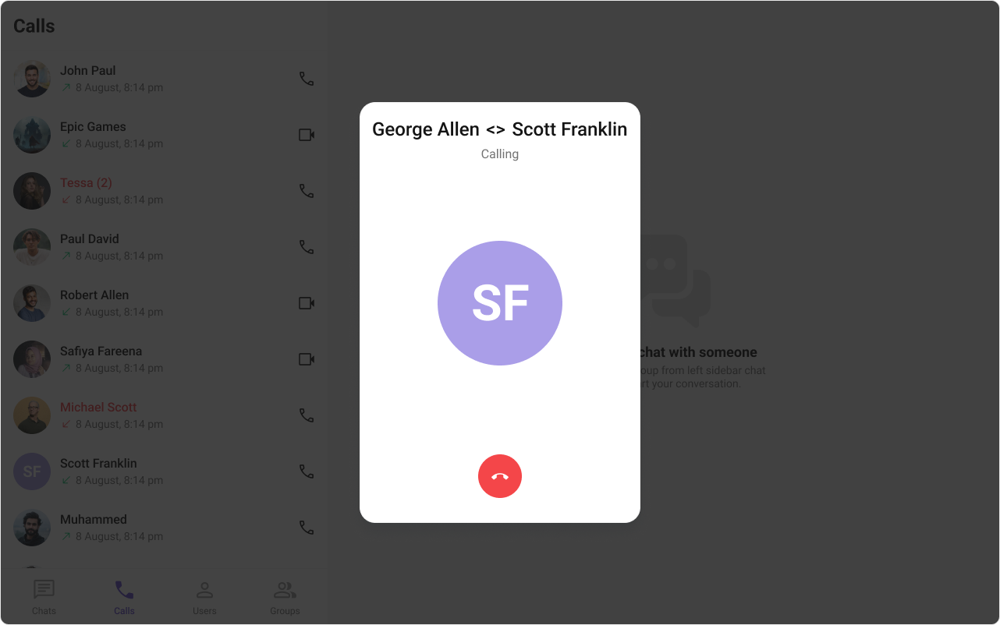
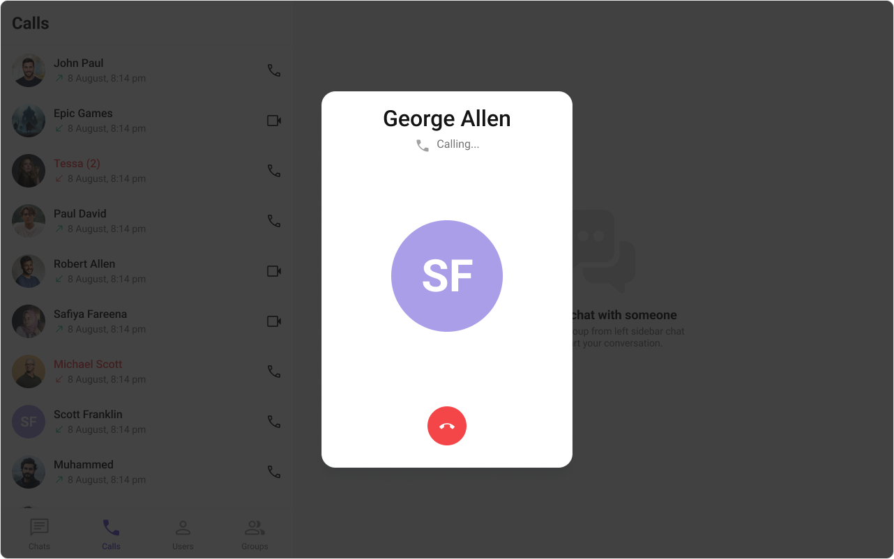
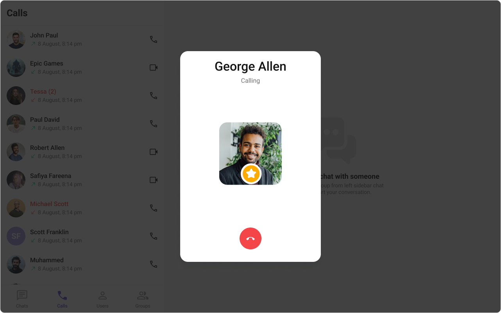

<Accordion title="AI Integration Quick Reference">

| Field | Value |
| --- | --- |
| Component | `CometChatOutgoingCall` |
| Package | `@cometchat/chat-uikit-react` |
| Import | `import { CometChatOutgoingCall } from "@cometchat/chat-uikit-react";` |
| CSS root class | `.cometchat-outgoing-call` |
| Primary output | `onCallCanceled: () => void` — fires when the user cancels the call |
| Prerequisites | App wrapped in [`CometChatProvider`](/ui-kit/react/cometchat-provider) with valid credentials + a logged-in user |
| Stitching | Pass the outgoing `call` object; wire `onCallCanceled` to dismiss the screen |
| Full props | See [Props](#props) |

</Accordion>

## Overview

`CometChatOutgoingCall` is a purely presentational component that displays the outgoing call screen while waiting for the receiver to answer. It shows the receiver's name, avatar, an "Outgoing Call" subtitle that changes to "Ringing..." once the receiver's device rings, and an end-call button.
<Info>
**Live Preview** — interact with the default outgoing call screen.

[Open in Storybook ↗](https://storybook.cometchat.io/react/?path=/story/components-calls-cometchat-outgoing-call--default)
</Info>

<iframe
  src="https://storybook.cometchat.io/react/iframe.html?id=components-calls-cometchat-outgoing-call--default&viewMode=story&shortcuts=false&singleStory=true"
  className="w-full rounded-xl"
  loading="lazy"
  style={{height: "700px", border: "1px solid #e0e0e0"}}
  title="CometChat Outgoing Call — Default"
  allow="clipboard-write"
></iframe>

The component handles:
- Displaying receiver name and avatar from the `call` object
- "Outgoing Call" subtitle text, then "Ringing..." once the receiver's device rings, for any call the kit placed (see [How calls ring](/ui-kit/react/call-features#how-calls-ring))
- End-call/cancel button
- Outgoing call sound playback (looping while mounted, pauses on unmount)

> **Required prop:** The `call` prop is required. The component needs a valid `CometChat.Call` object to render receiver information.

> **Typical usage:** `CometChatOutgoingCall` is typically rendered by `CometChatCallButtons` (inside `CometChatMessageHeader`) when a call is placed, but it can be used standalone.

---

## Usage

### Flat API

```tsx
import type { CometChat } from "@cometchat/chat-sdk-javascript";
import { CometChatOutgoingCall } from "@cometchat/chat-uikit-react";

function OutgoingCallScreen({ call, onCancel }: { call: CometChat.Call; onCancel: () => void }) {
  return <CometChatOutgoingCall call={call} onCallCanceled={onCancel} />;
}
```

`CometChatOutgoingCall` only draws the screen: `onCallCanceled` must cancel the call itself.

### Standalone Usage Example

To place and cancel a call the way the kit does, so that it rings through the Calls SDK, use the `useCometChatCallButtons` hook. It places the call, gives you `activeCall` for this screen and `cancelOutgoingCall` for its button, and tells you when to show the ongoing call:

```tsx
import { CometChat } from "@cometchat/chat-sdk-javascript";
import {
  CometChatOngoingCall,
  CometChatOutgoingCall,
  useCometChatCallButtons,
} from "@cometchat/chat-uikit-react";

function CallManager({ user }: { user: CometChat.User }) {
  const {
    activeCall,
    callButtonsDisabled,
    showOutgoingCallScreen,
    showOngoingCall,
    callSessionId,
    initiateVideoCall,
    cancelOutgoingCall,
    resetCallState,
  } = useCometChatCallButtons({ user });

  return (
    <div>
      <button disabled={callButtonsDisabled} onClick={initiateVideoCall}>
        Video call
      </button>
      {showOutgoingCallScreen && activeCall && (
        <CometChatOutgoingCall call={activeCall} onCallCanceled={cancelOutgoingCall} />
      )}
      {showOngoingCall && callSessionId && (
        <CometChatOngoingCall sessionID={callSessionId} onCallEnded={resetCallState} />
      )}
    </div>
  );
}
```

A call placed with `CometChat.initiateCall` and cancelled with `CometChat.rejectCall` goes the legacy way instead: it isn't on the ringing flow, and its screen never shows "Ringing...". See [Custom Call Screens](/ui-kit/react/guide-custom-call-screens) for the hook's full API.

---

## Actions and Events

### Callback Props

| Prop | Signature | Fires when |
| --- | --- | --- |
| `onCallCanceled` | `() => void` | User clicks the cancel/end button |
| `onError` | `((error: CometChat.CometChatException) => void) \| null` | SDK error occurs |

### Events Emitted

This component does not emit any UI events.

### Events Received

This component does not subscribe to any UI events from other components.

### SDK Listeners (Automatic)

This component does not attach any SDK listeners. It is purely presentational — the parent component is responsible for managing call state transitions (e.g., listening for `onOutgoingCallAccepted` or `onOutgoingCallRejected`).

---

## Customization

### View Props

Use view props to replace sections of the default UI while keeping the component's behavior intact:

```tsx
<CometChatOutgoingCall
  call={call}
  titleView={<span className="custom-title">{call.getReceiver().getName()}</span>}
  subtitleView={<span>Ringing...</span>}
  avatarView={}
  cancelButtonView={<button onClick={handleCancel}>End Call</button>}
/>
```

| Slot | Type | Replaces |
| --- | --- | --- |
| `titleView` | `ReactNode` | Receiver name |
| `subtitleView` | `ReactNode` | "Outgoing Call" / "Ringing..." text |
| `avatarView` | `ReactNode` | Receiver avatar |
| `cancelButtonView` | `ReactNode` | End-call button |

#### titleView

<Frame>
  
</Frame>

<Tabs>
<Tab title="TypeScript">
```tsx
import type { Call } from "@cometchat/chat-sdk-javascript";
import { CometChatOutgoingCall } from "@cometchat/chat-uikit-react";

function OutgoingCallCustomTitle({ call }: { call: Call }) {
  return (
    <CometChatOutgoingCall
      call={call}
      titleView={
        <div className="outgoing-call__title">
          {call.getCallInitiator().getName()} {" <> "} {call.getCallReceiver().getName()}
        </div>
      }
    />
  );
}
```
</Tab>
<Tab title="CSS">
```css
.outgoing-call__title {
  color: #141414;
  text-align: center;
  font: 500 24px Roboto;
}
```
</Tab>
</Tabs>

#### subtitleView

<Frame>
  
</Frame>

<Tabs>
<Tab title="TypeScript">
```tsx
import type { Call } from "@cometchat/chat-sdk-javascript";
import { CometChatOutgoingCall } from "@cometchat/chat-uikit-react";

function OutgoingCallCustomSubtitle({ call }: { call: Call }) {
  return (
    <CometChatOutgoingCall
      call={call}
      subtitleView={
        <div className="outgoing-call__subtitle">
          <div className="outgoing-call__subtitle-icon" />
          {"Calling..."}
        </div>
      }
    />
  );
}
```
</Tab>
<Tab title="CSS">
```css
.outgoing-call__subtitle {
  display: flex;
  justify-content: center;
  align-items: flex-start;
  gap: 8px;
  color: #727272;
  text-align: center;
  font: 400 16px Roboto;
}

.outgoing-call__subtitle-icon {
  background: #a1a1a1;
  height: 24px;
  width: 24px;
}
```
</Tab>
</Tabs>

#### avatarView

<Frame>
  
</Frame>

<Tabs>
<Tab title="TypeScript">
```tsx
import type { Call, User } from "@cometchat/chat-sdk-javascript";
import { CometChatOutgoingCall, CometChatAvatar } from "@cometchat/chat-uikit-react";

function OutgoingCallCustomAvatar({ call }: { call: Call }) {
  return (
    <CometChatOutgoingCall
      call={call}
      avatarView={
        <div className="outgoing-call__avatar">
          <CometChatAvatar.Root
            name={call.getCallReceiver()?.getName()}
            image={(call.getCallReceiver() as User)?.getAvatar()}
          >
            <CometChatAvatar.Image />
            <CometChatAvatar.Initials />
          </CometChatAvatar.Root>
        </div>
      }
    />
  );
}
```
</Tab>
<Tab title="CSS">
```css
.outgoing-call__avatar .cometchat-avatar {
  width: 160px;
  height: 160px;
  border-radius: 20px;
}
```
</Tab>
</Tabs>

### CSS Styling

Override design tokens on the component selector:

```css
.cometchat-outgoing-call {
  --cometchat-background-color-01: #1a1a2e;
  --cometchat-text-color-primary: #ffffff;
}

.cometchat-outgoing-call__button {
  background: var(--cometchat-error-color);
}
```

---

## Props

The `call` prop is required. All other props are optional.

---

### call

The CometChat call object representing the outgoing call. **Required.**

| | |
| --- | --- |
| Type | `CometChat.Call` |
| Required | Yes |

---

### disableSoundForCalls

Disable the outgoing call sound.

| | |
| --- | --- |
| Type | `boolean` |
| Default | `false` |

---

### customSoundForCalls

Custom sound URL to play during the outgoing call (replaces the built-in sound).

| | |
| --- | --- |
| Type | `string` |
| Default | Built-in outgoing call sound |

---

### onCallCanceled

Callback when the user clicks the cancel/end button.

| | |
| --- | --- |
| Type | `() => void` |
| Default | `undefined` |

---

### onError

Callback when an SDK error occurs.

| | |
| --- | --- |
| Type | `((error: CometChat.CometChatException) => void) \| null` |
| Default | `null` |

---

### titleView

Custom view that replaces the receiver name.

| | |
| --- | --- |
| Type | `ReactNode` |
| Default | `undefined` |

---

### subtitleView

Custom view that replaces the "Outgoing Call" / "Ringing..." text.

| | |
| --- | --- |
| Type | `ReactNode` |
| Default | `undefined` |

---

### avatarView

Custom view that replaces the receiver avatar.

| | |
| --- | --- |
| Type | `ReactNode` |
| Default | `undefined` |

---

### cancelButtonView

Custom view that replaces the end-call button.

| | |
| --- | --- |
| Type | `ReactNode` |
| Default | `undefined` |

---

### className

Additional CSS class name applied to the root element.

| | |
| --- | --- |
| Type | `string` |
| Default | `undefined` |

---

## CSS Selectors

| Target | Selector |
| --- | --- |
| Root container | `.cometchat-outgoing-call` |
| Title container | `.cometchat-outgoing-call__title-container` |
| Title | `.cometchat-outgoing-call__title` |
| Subtitle | `.cometchat-outgoing-call__subtitle` |
| Avatar | `.cometchat-outgoing-call__avatar` |
| Cancel button | `.cometchat-outgoing-call__button` |
| Cancel button icon | `.cometchat-outgoing-call__button-icon` |

---

## Next Steps

<CardGroup cols={2}>
  <Card title="Incoming Call" icon="phone-arrow-down-left" href="/ui-kit/react/components/incoming-call">
    Handle incoming call notifications with accept/decline actions
  </Card>
  <Card title="Call Logs" icon="clock-rotate-left" href="/ui-kit/react/components/call-logs">
    Browse call history and re-initiate calls
  </Card>
  <Card title="Theming" icon="paintbrush" href="/ui-kit/react/theming">
    Customize colors, fonts, and spacing
  </Card>
</CardGroup>
